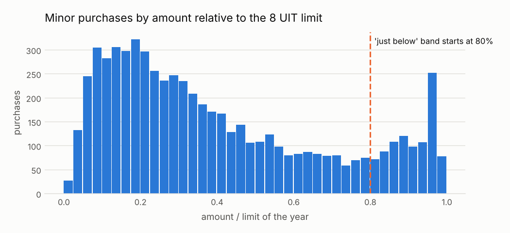

# C01 · Compras partidas para no hacer concurso

!!! warning "Signals, never accusations"
    An alert means *"this deserves a review"*, not *"there is an irregularity"*. No supplier,
    official or person is ranked or named; public entities appear only in aggregated views.


| | |
|---|---|
| **Control objective** | Que las compras que por su valor total deberían ir a un procedimiento competitivo no se fragmenten en varias compras menores. |
| **Risk mitigated** | Evitar la competencia y los controles de un procedimiento más exigente partiendo un requerimiento en compras justo debajo del límite de 8 UIT. |
| **Threshold** | 3 o más compras entre 80% y 100% de 8 UIT, mismo comprador, proveedor y segmento, en 30 días, con suma mayor a 8 UIT |
| **Frequency** | mensual |
| **Owner role** | Responsable de Logística/Abastecimiento, con Control Interno |
| **Evidence generated** | Grupo de compras, procesos que lo forman, fechas, montos, total del grupo frente al límite, segmento UNSPSC |
| **Level** | process |
| **Weight in risk score** | 0.55 - Patrón fuerte cuando aparece, pero las compras recurrentes legítimas son comunes. |
| **Methodological reference** | OCP Red Flags for Integrity (2016), etapa de convocatoria: fraccionamiento de contratos para evitar procedimientos competitivos |

## Rule

Para un mismo comprador, proveedor y segmento UNSPSC, marcar cada compra menor (no competitiva) cuyo monto esté entre near_limit_ratio × límite y el límite, cuando al menos min_purchases compras así caen dentro de window_days desde la primera y su suma supera el límite del año. El límite es minor_purchase_limit_uit × la UIT del año de la compra.

### Parameters

| parameter | value | unit | origin |
|---|---|---|---|
| limit_uit | 8 | UIT | `thresholds.yaml: minor_purchase_limit_uit.value` (verified_secondary) |
| near_limit_ratio | 0.8 | proporción | catalog literal - política interna: «justo debajo» = el 20% superior de la banda |
| window_days | 30 | días | catalog literal - política interna: un ciclo mensual de compras |
| min_purchases | 3 | cantidad | catalog literal |
| minor_methods | direct |  | catalog literal - valores de procurementMethod de OCDS tratados como compras menores o directas |

### Expected false positives - media-alta (entre 30 y 60 de cada 100 alertas resultan normales)

* Consumibles recurrentes comprados cada mes al proveedor habitual (combustible, alimentos, limpieza)
* Necesidades realmente imprevistas en la misma categoría
* Órdenes de un acuerdo marco publicadas como compras separadas

## Distribution



Minor purchases pile up just under the limit. Part of that pile is legitimate, because budgets get sized to the limit, so C01 also requires repetition with the same supplier inside a short window. *Synthetic-data caveat:* the spike at 96-97% is partly an artefact of the generator, which caps the amount distribution there (see Scope & limitations). On real data, the height of this pile is itself a metric worth tracking by entity type.

Data behind the chart: `outputs/distributions/c01_distribution.csv`.

## Results of this run

| year | alerts | processes | mean_severity |
|---|---|---|---|
| 2024 | 49 | 49 | 0.84 |
| 2025 | 64 | 64 | 0.83 |

### Validation on injected patterns

| injected_pattern | injected | detected | recall | alerts | on_target_pattern | on_other_injected_pattern | on_background | precision_vs_target | background_fp_share | background_alert_rate_pct |
|---|---|---|---|---|---|---|---|---|---|---|
| split_purchase | 102 | 102 | 1.0 | 113 | 102 | 3 | 8 | 0.903 | 0.071 | 0.07 |

See [Validation](../validation.md).

## Exact rule (SQL executed by the engine)

```sql
-- C01 Compras partidas debajo del límite de compra menor.
-- Columnas de salida (controles por proceso): ocid, buyer_id, supplier_id, year, severity, scope_key, evidence
WITH near AS (
    SELECT a.ocid, a.buyer_id, a.supplier_id, a.segment, a.year,
           CAST(a.award_date AS DATE) AS d, a.amount, r.limit_pen
    FROM f_award a
    JOIN ref_minor_limit r ON r.year = a.year
    WHERE list_contains($minor_methods, a.procurement_method)
      AND a.amount IS NOT NULL
      AND a.amount <= r.limit_pen
      AND a.amount >= $near_limit_ratio * r.limit_pen
),
clusters AS (
    -- cada compra cercana al límite abre una ventana; los miembros son las compras dentro de ella
    SELECT x.ocid AS anchor, x.buyer_id, x.supplier_id, x.segment, x.year, x.d AS start_date,
           max(x.limit_pen) AS limit_pen, count(*) AS n, sum(y.amount) AS total,
           list(y.ocid ORDER BY y.d, y.ocid) AS members,
           list(y.amount ORDER BY y.d, y.ocid) AS amounts
    FROM near x
    JOIN near y
      ON y.buyer_id = x.buyer_id AND y.supplier_id = x.supplier_id AND y.segment = x.segment
     AND y.d BETWEEN x.d AND x.d + CAST($window_days AS INTEGER)
    GROUP BY ALL
    HAVING count(*) >= $min_purchases AND sum(y.amount) > max(x.limit_pen)
),
flagged AS (
    SELECT unnest(members) AS ocid, c.*
    FROM clusters c
)
SELECT f.ocid, f.buyer_id, f.supplier_id, f.year,
       least(1.0, arg_max(f.n, f.n) / 5.0) AS severity,
       arg_max(f.buyer_id || '|' || f.supplier_id || '|' || f.segment || '|' || f.start_date, f.n) AS scope_key,
       to_json(arg_max(struct_pack(
           n_purchases := f.n, cluster_total := round(f.total, 2), limit_pen := f.limit_pen,
           total_vs_limit := round(f.total / f.limit_pen, 2), window_start := f.start_date,
           segment := f.segment, members := f.members, amounts := f.amounts), f.n))::VARCHAR AS evidence
FROM flagged f
GROUP BY f.ocid, f.buyer_id, f.supplier_id, f.year
```
