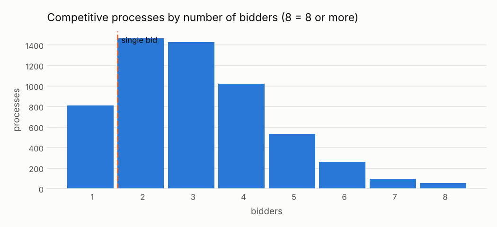

# C02 · Un solo postor en un concurso abierto

!!! warning "Signals, never accusations"
    An alert means *"this deserves a review"*, not *"there is an irregularity"*. No supplier,
    official or person is ranked or named; public entities appear only in aggregated views.


| | |
|---|---|
| **Control objective** | Que los procedimientos competitivos atraigan competencia real. |
| **Risk mitigated** | Especificaciones restrictivas, poca difusión o colusión que dejan un solo postor y eliminan la disciplina de precios. |
| **Threshold** | postores = 1 |
| **Frequency** | mensual |
| **Owner role** | Responsable de Logística/Abastecimiento |
| **Evidence generated** | Proceso, método, número de postores, monto adjudicado |
| **Level** | process |
| **Weight in risk score** | 0.35 - Muy frecuente y muchas veces estructural; evidencia débil sola, valiosa combinada. |
| **Methodological reference** | OCP Cardinal R018 (Single bid received); OCP Red Flags for Integrity (2016) |

## Rule

Marcar cada proceso cuyo procurementMethod está en competitive_methods y cuyo número de postores distintos (según las ofertas, o numberOfTenderers si no hay ofertas) es 1.

### Parameters

| parameter | value | unit | origin |
|---|---|---|---|
| competitive_methods | open, selective |  | catalog literal - valor por defecto de Cardinal |

### Expected false positives - alta (entre 50 y 80 de cada 100 alertas resultan normales)

* Mercados pequeños (equipos especializados, regiones alejadas)
* Procesos convocados de nuevo después de quedar desiertos
* Datos de ofertas incompletos en la publicación (solo se cuentan los postores publicados)

## Distribution



14.3% of competitive processes received a single bid. When the rate is this common, the signal becomes informative only in combination with others or when an entity's rate stands well above the national rate for the method.

Data behind the chart: `outputs/distributions/c02_distribution.csv`.

## Results of this run

| year | alerts | processes | mean_severity |
|---|---|---|---|
| 2024 | 403 | 403 | 1.0 |
| 2025 | 407 | 407 | 1.0 |

### Validation on injected patterns

| injected_pattern | injected | detected | recall | alerts | on_target_pattern | on_other_injected_pattern | on_background | precision_vs_target | background_fp_share | background_alert_rate_pct |
|---|---|---|---|---|---|---|---|---|---|---|
| single_bid | 60 | 60 | 1.0 | 810 | 60 | 89 | 661 | 0.074 | 0.816 | 5.95 |

See [Validation](../validation.md).

## Exact rule (SQL executed by the engine)

```sql
-- C02 Un solo postor en un procedimiento competitivo (Cardinal R018).
SELECT p.ocid, p.buyer_id, a.supplier_id, p.year,
       1.0 AS severity,
       p.method_details AS scope_key,
       to_json(struct_pack(method := p.method_details, procurement_method := p.procurement_method,
                           n_bidders := p.n_tenderers, award_amount := a.amount))::VARCHAR AS evidence
FROM f_process p
LEFT JOIN (SELECT ocid, arg_min(supplier_id, award_id) AS supplier_id, sum(amount) AS amount
           FROM f_award GROUP BY ocid) a USING (ocid)
WHERE list_contains($competitive_methods, p.procurement_method)
  AND p.n_tenderers = 1
```
