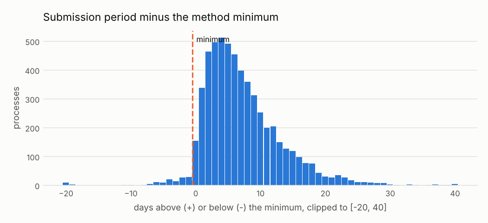

# C03 · Abnormally short submission period

!!! warning "Signals, never accusations"
    An alert means *"this deserves a review"*, not *"there is an irregularity"*. No supplier,
    official or person is ranked or named; public entities appear only in aggregated views.


| | |
|---|---|
| **Control objective** | Bidders get enough time to prepare offers. |
| **Risk mitigated** | A deadline too short to compete, which favours a bidder who knew in advance. |
| **Threshold** | period < method minimum (calendar days; see thresholds.yaml) |
| **Frequency** | weekly (during the call) |
| **Owner role** | Procurement controller; Selection committee secretary |
| **Evidence generated** | OCID, method, start, end, days, minimum applied |
| **Level** | process |
| **Weight in risk score** | 0.5 - Specific and actionable when the period is checked against the right minimum. |
| **Methodological reference** | OCP Cardinal R003 - Short submission period; OCP Red Flags for Integrity (2016) |

## Rule

For competitive processes with a valid tender period, flag when the whole days between tenderPeriod.startDate and tenderPeriod.endDate are below the minimum for the method (min_submission_days.by_method), or below the default when the method is not listed.

### Parameters

| parameter | value | unit | origin |
|---|---|---|---|
| default_min_days | 15 | days | `thresholds.yaml: min_submission_days.default.value` (methodological) |
| by_method | Licitación pública: 22; Concurso público: 22; Adjudicación simplificada: 8; Comparación de precios: 5; Subasta inversa electrónica: 5 |  | `thresholds.yaml: min_submission_days.by_method` (methodological) |

### Expected false positives - medium (20-40% legitimate)

* Urgency procedures with legally shorter periods
* Second calls (re-launch) published with reduced terms
* Date-capture errors in the publication

## Distribution



Bars left of the line are processes whose call was shorter than the minimum for their method.

Data behind the chart: `outputs/distributions/c03_distribution.csv`.

## Results of this run

| year | alerts | processes | mean_severity |
|---|---|---|---|
| 2024 | 72 | 72 | 0.47 |
| 2025 | 62 | 62 | 0.46 |

### Validation on injected patterns

| injected_pattern | injected | detected | recall | alerts | on_target_pattern | on_other_injected_pattern | on_background | precision_vs_target | background_fp_share | background_alert_rate_pct |
|---|---|---|---|---|---|---|---|---|---|---|
| short_submission_period | 50 | 50 | 1.0 | 134 | 50 | 14 | 70 | 0.373 | 0.522 | 0.63 |

See [Validation](../validation.md).

## Exact rule (SQL executed by the engine)

```sql
-- C03 Abnormally short submission period (Cardinal R003, method-specific minimums).
WITH periods AS (
    SELECT p.ocid, p.buyer_id, p.year, p.method_details, p.tender_start, p.tender_end,
           date_diff('day', CAST(p.tender_start AS DATE), CAST(p.tender_end AS DATE)) AS days,
           coalesce(r.min_days, $default_min_days) AS min_days
    FROM f_process p
    LEFT JOIN ref_min_submission_days r ON r.method_details = p.method_details
    WHERE p.is_competitive AND p.tender_start IS NOT NULL AND p.tender_end IS NOT NULL
)
SELECT s.ocid, s.buyer_id, a.supplier_id, s.year,
       greatest(0.1, 1.0 - s.days / s.min_days) AS severity,
       s.method_details AS scope_key,
       to_json(struct_pack(method := s.method_details, start := s.tender_start, "end" := s.tender_end,
                           days := s.days, min_days := s.min_days))::VARCHAR AS evidence
FROM periods s
LEFT JOIN (SELECT ocid, arg_min(supplier_id, award_id) AS supplier_id FROM f_award GROUP BY ocid) a
       USING (ocid)
WHERE s.days < s.min_days
```
