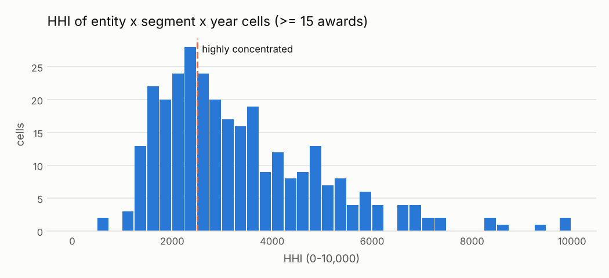

# C04 · Supplier concentration by entity and category (HHI)

!!! warning "Signals, never accusations"
    An alert means *"this deserves a review"*, not *"there is an irregularity"*. No supplier,
    official or person is ranked or named; public entities appear only in aggregated views.


| | |
|---|---|
| **Control objective** | Spending in each entity and category is not captured by one supplier. |
| **Risk mitigated** | Capture of a buyer's category by a supplier, favouritism, lock-in. |
| **Threshold** | HHI > 2,500, >= 15 awards in the cell, top supplier with >= 3 of them |
| **Frequency** | quarterly |
| **Owner role** | Category manager; Internal Control |
| **Evidence generated** | Cell (buyer-segment-year), HHI, number of awards and suppliers, top-supplier share |
| **Level** | process |
| **Weight in risk score** | 0.3 - A structural indicator for the cell, not proof about the individual process. |
| **Methodological reference** | OCP Red Flags for Integrity (2016) - market concentration / supplier dominance (no Cardinal code mapped) |

## Rule

For each buyer x UNSPSC segment x year with at least min_awards awards with a usable amount, compute HHI = sum over suppliers of (share of awarded amount x 100)^2. When HHI exceeds hhi_threshold and the supplier with the largest share holds at least min_top_awards awards in the cell, flag the processes awarded to that supplier.

### Parameters

| parameter | value | unit | origin |
|---|---|---|---|
| hhi_threshold | 2500 | HHI points (0-10,000) | `thresholds.yaml: hhi_highly_concentrated.value` (methodological) |
| min_awards | 15 | count | catalog literal - below this, HHI is high by construction |
| min_top_awards | 3 | count | catalog literal - dominance must come from repeated awards, not one large contract |

### Expected false positives - medium-high (30-60% legitimate)

* Natural monopolies or exclusive distributors (patented drugs, utilities)
* Small cells close to the minimum size
* One large contract dominating the amount of a cell

## Distribution



Many cells are concentrated by amount because one large contract dominates them. C04 therefore flags only cells where the dominant supplier also holds several awards.

Data behind the chart: `outputs/distributions/c04_distribution.csv`.

## Results of this run

| year | alerts | processes | mean_severity |
|---|---|---|---|
| 2024 | 339 | 339 | 0.4 |
| 2025 | 233 | 233 | 0.34 |

### Validation on injected patterns

| injected_pattern | injected | detected | recall | alerts | on_target_pattern | on_other_injected_pattern | on_background | precision_vs_target | background_fp_share | background_alert_rate_pct |
|---|---|---|---|---|---|---|---|---|---|---|
| supplier_concentration | 143 | 143 | 1.0 | 572 | 143 | 37 | 392 | 0.25 | 0.685 | 3.53 |

See [Validation](../validation.md).

## Exact rule (SQL executed by the engine)

```sql
-- C04 Supplier concentration by entity and category (HHI on awarded amount).
WITH by_supplier AS (
    SELECT buyer_id, segment, year, supplier_id, sum(amount) AS amt, count(*) AS n
    FROM f_award WHERE amount IS NOT NULL
    GROUP BY ALL
),
hhi AS (
    SELECT b.buyer_id, b.segment, b.year,
           sum(power(100.0 * b.amt / t.total, 2)) AS hhi,
           any_value(t.total) AS total, any_value(t.n_awards) AS n_awards, count(*) AS n_suppliers,
           arg_max(b.supplier_id, b.amt) AS top_supplier, arg_max(b.n, b.amt) AS top_awards, max(b.amt) / any_value(t.total) AS top_share
    FROM by_supplier b
    JOIN (SELECT buyer_id, segment, year, sum(amt) AS total, sum(n) AS n_awards
          FROM by_supplier GROUP BY ALL) t USING (buyer_id, segment, year)
    GROUP BY ALL
)
SELECT a.ocid, a.buyer_id, a.supplier_id, a.year,
       (h.hhi - $hhi_threshold) / (10000.0 - $hhi_threshold) AS severity,
       h.buyer_id || '|' || h.segment || '|' || h.year AS scope_key,
       to_json(struct_pack(segment := h.segment, hhi := round(h.hhi, 0), n_awards := h.n_awards,
                           n_suppliers := h.n_suppliers, top_supplier_share := round(h.top_share, 3), top_supplier_awards := h.top_awards,
                           cell_total := round(h.total, 2)))::VARCHAR AS evidence
FROM hhi h
JOIN f_award a ON a.buyer_id = h.buyer_id AND a.segment = h.segment AND a.year = h.year
              AND a.supplier_id = h.top_supplier AND a.amount IS NOT NULL
WHERE h.n_awards >= $min_awards AND h.hhi > $hhi_threshold AND h.top_awards >= $min_top_awards
```
