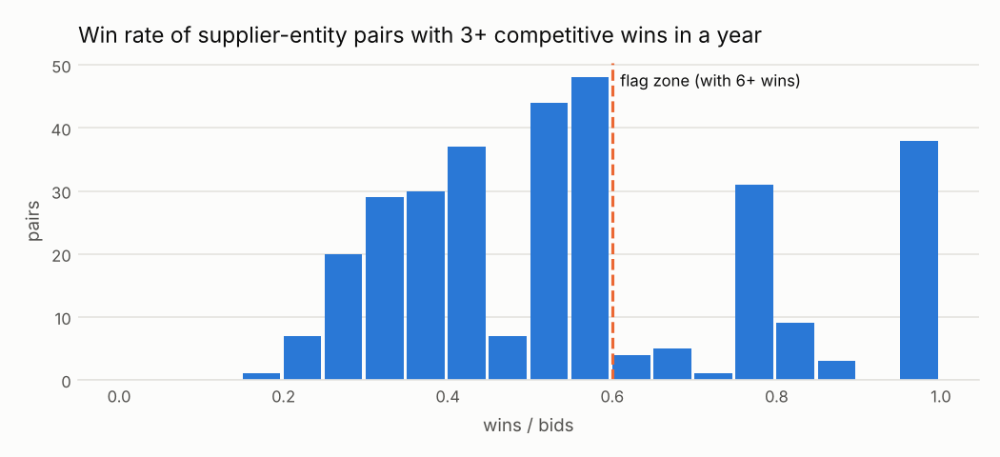

# C05 · El mismo ganador una y otra vez en la misma entidad

!!! warning "Signals, never accusations"
    An alert means *"this deserves a review"*, not *"there is an irregularity"*. No supplier,
    official or person is ranked or named; public entities appear only in aggregated views.


| | |
|---|---|
| **Control objective** | Que los concursos de una entidad se repartan según las condiciones del mercado. |
| **Risk mitigated** | Colusión entre postores (rotación u ofertas de cobertura), favoritismo del comité. |
| **Threshold** | 6 o más victorias en un año en una entidad, ganando al menos 60 de cada 100 veces |
| **Frequency** | trimestral |
| **Owner role** | Control Interno; Responsable de Logística |
| **Evidence generated** | Comprador-proveedor-año, victorias, ofertas presentadas, tasa de éxito, procesos ganados |
| **Level** | process |
| **Weight in risk score** | 0.45 - Usa el comportamiento de las ofertas, no solo los resultados; razonablemente específica. |
| **Methodological reference** | OCP Red Flags for Integrity (2016): el mismo proveedor gana repetidamente (sin código Cardinal asignado) |

## Rule

Para cada comprador × proveedor × año, entre procesos competitivos, contar victorias y procesos en que el proveedor ofertó. Marcar los procesos ganados cuando victorias ≥ min_wins y victorias / ofertas ≥ min_win_rate.

### Parameters

| parameter | value | unit | origin |
|---|---|---|---|
| min_wins | 6.0 | cantidad | catalog literal |
| min_win_rate | 0.6 | proporción | catalog literal - bajó de 0.80 tras la primera corrida simulada, ver D19 |

### Expected false positives - media (entre 25 y 50 de cada 100 alertas resultan normales)

* Un proveedor local eficiente con los precios más bajos
* Datos de ofertas incompletos (si no se publican las ofertas perdedoras, la tasa de éxito parece mayor)

## Distribution



Pairs right of the line with six or more wins are flagged.

Data behind the chart: `outputs/distributions/c05_distribution.csv`.

## Results of this run

| year | alerts | processes | mean_severity |
|---|---|---|---|
| 2024 | 136 | 136 | 0.77 |
| 2025 | 65 | 65 | 0.69 |

### Validation on injected patterns

| injected_pattern | injected | detected | recall | alerts | on_target_pattern | on_other_injected_pattern | on_background | precision_vs_target | background_fp_share | background_alert_rate_pct |
|---|---|---|---|---|---|---|---|---|---|---|
| repeated_winner | 89 | 89 | 1.0 | 201 | 89 | 74 | 38 | 0.443 | 0.189 | 0.34 |

See [Validation](../validation.md).

## Exact rule (SQL executed by the engine)

```sql
-- C05 El mismo ganador repetido en la misma entidad (procesos competitivos).
WITH bids AS (
    SELECT buyer_id, supplier_id, year, count(DISTINCT ocid) AS n_bids
    FROM f_bid WHERE is_competitive GROUP BY ALL
),
wins AS (
    SELECT buyer_id, supplier_id, year, count(DISTINCT ocid) AS n_wins,
           list(DISTINCT ocid) AS won
    FROM f_award WHERE is_competitive GROUP BY ALL
),
pairs AS (
    SELECT w.*, greatest(b.n_bids, w.n_wins) AS n_bids,
           w.n_wins / greatest(b.n_bids, w.n_wins) AS win_rate
    FROM wins w LEFT JOIN bids b USING (buyer_id, supplier_id, year)
    WHERE w.n_wins >= $min_wins
)
SELECT unnest(p.won) AS ocid, p.buyer_id, p.supplier_id, p.year,
       p.win_rate * least(1.0, p.n_wins / (2.0 * $min_wins)) AS severity,
       p.buyer_id || '|' || p.supplier_id || '|' || p.year AS scope_key,
       to_json(struct_pack(wins := p.n_wins, bids := p.n_bids,
                           win_rate := round(p.win_rate, 3)))::VARCHAR AS evidence
FROM pairs p
WHERE p.win_rate >= $min_win_rate
```
