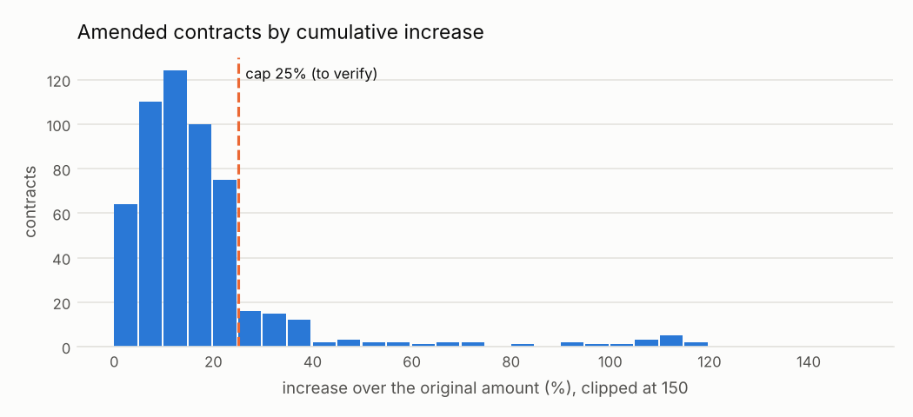

# C06 · Contratos que crecen demasiado después de firmados

!!! warning "Signals, never accusations"
    An alert means *"this deserves a review"*, not *"there is an irregularity"*. No supplier,
    official or person is ranked or named; public entities appear only in aggregated views.


| | |
|---|---|
| **Control objective** | Que las modificaciones no superen los límites que justificó la competencia original. |
| **Risk mitigated** | Una oferta baja recuperada después con adendas, o trabajo nuevo sin un nuevo procedimiento. |
| **Threshold** | aumento acumulado mayor a 25% (por verificar bajo la Ley 32069) |
| **Frequency** | mensual |
| **Owner role** | Administrador del contrato; Control Interno |
| **Evidence generated** | Proceso, contrato, monto original, monto modificado, % de aumento, número de modificaciones |
| **Level** | process |
| **Weight in risk score** | 0.6 - Impacto económico directo y referencia legal clara una vez verificado el tope. |
| **Methodological reference** | OCP Red Flags for Integrity (2016), etapa de ejecución: modificaciones contractuales y sobrecostos |

## Rule

Para cada contrato con modificaciones que publican un monto total actualizado, calcular aumento = último monto modificado / monto original − 1 y marcar cuando supera cap.

### Parameters

| parameter | value | unit | origin |
|---|---|---|---|
| cap | 0.25 | proporción | `thresholds.yaml: amendment_increase_cap.value` (to_verify) |

### Expected false positives - media (entre 20 y 40 de cada 100 alertas resultan normales)

* Adicionales de obra aprobados (las obras tienen límites distintos)
* Reajustes de precio por fórmula publicados como modificaciones
* Monto modificado publicado con impuestos cuando el original no los incluía

## Distribution



Most amendments stay well under the cap; the tail beyond it is what C06 reviews.

Data behind the chart: `outputs/distributions/c06_distribution.csv`.

## Results of this run

| year | alerts | processes | mean_severity |
|---|---|---|---|
| 2024 | 33 | 33 | 0.39 |
| 2025 | 39 | 39 | 0.3 |

### Validation on injected patterns

| injected_pattern | injected | detected | recall | alerts | on_target_pattern | on_other_injected_pattern | on_background | precision_vs_target | background_fp_share | background_alert_rate_pct |
|---|---|---|---|---|---|---|---|---|---|---|
| amendment_increase | 30 | 30 | 1.0 | 72 | 30 | 7 | 35 | 0.417 | 0.486 | 0.32 |

See [Validation](../validation.md).

## Exact rule (SQL executed by the engine)

```sql
-- C06 Modificaciones contractuales que suben el monto por encima del tope.
SELECT c.ocid, c.buyer_id, c.supplier_id, c.year,
       least(1.0, (c.final_amount / c.original_amount - 1 - $cap) / (1 - $cap)) AS severity,
       c.contract_id AS scope_key,
       to_json(struct_pack(contract_id := c.contract_id, original_amount := c.original_amount,
                           amended_amount := c.final_amount,
                           increase_pct := round(100 * (c.final_amount / c.original_amount - 1), 1),
                           n_amendments := c.n_amendments))::VARCHAR AS evidence
FROM f_contract c
WHERE c.final_amount IS NOT NULL AND c.original_amount > 0
  AND c.final_amount / c.original_amount - 1 > $cap
```
