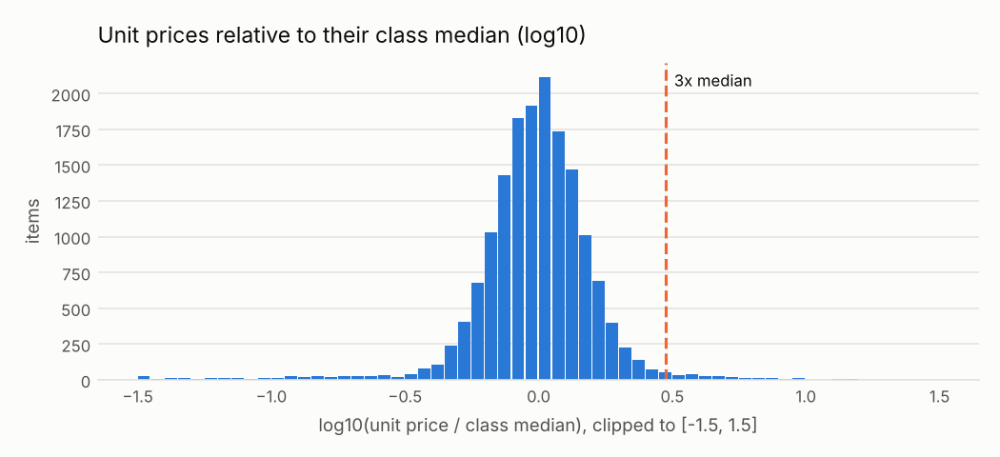

# C07 · Precios muy por encima de lo que pagan otros

!!! warning "Signals, never accusations"
    An alert means *"this deserves a review"*, not *"there is an irregularity"*. No supplier,
    official or person is ranked or named; public entities appear only in aggregated views.


| | |
|---|---|
| **Control objective** | Que los precios pagados estén en línea con lo que pagan otras entidades por la misma clase de artículo. |
| **Risk mitigated** | Sobreprecios, especificaciones infladas o errores de unidad o cantidad que los esconden. |
| **Threshold** | precio unitario 3 o más veces la mediana de su clase (clases con 20 o más artículos) |
| **Frequency** | mensual |
| **Owner role** | Responsable de la categoría de compra; control de costos |
| **Evidence generated** | Proceso, clase del artículo, precio unitario, mediana de la clase, cuántas veces la supera, tamaño del grupo |
| **Level** | process |
| **Weight in risk score** | 0.5 - El precio es donde está el dinero; la mezcla dentro de las clases limita la especificidad. |
| **Methodological reference** | OCP Red Flags for Integrity (2016), etapa de adjudicación: precios lejos del mercado o inflados |

## Rule

Para cada clase UNSPSC con al menos min_group artículos con precio, calcular la mediana del precio unitario adjudicado. Marcar los artículos cuyo precio unitario es al menos ratio veces esa mediana.

### Parameters

| parameter | value | unit | origin |
|---|---|---|---|
| ratio | 3.0 | veces la mediana | catalog literal |
| min_group | 20.0 | cantidad | catalog literal |

### Expected false positives - media-alta (entre 30 y 60 de cada 100 alertas resultan normales)

* Clases que mezclan artículos básicos y de alta gama
* Diferencias en la unidad de medida (caja contra unidad)
* Entregas pequeñas o en zonas alejadas con mayor costo logístico

## Distribution



A log scale makes 'three times the median' and 'a third of it' symmetric.

Data behind the chart: `outputs/distributions/c07_distribution.csv`.

## Results of this run

| year | alerts | processes | mean_severity |
|---|---|---|---|
| 2024 | 115 | 115 | 0.69 |
| 2025 | 103 | 103 | 0.72 |

### Validation on injected patterns

| injected_pattern | injected | detected | recall | alerts | on_target_pattern | on_other_injected_pattern | on_background | precision_vs_target | background_fp_share | background_alert_rate_pct |
|---|---|---|---|---|---|---|---|---|---|---|
| price_outlier | 40 | 38 | 0.95 | 218 | 38 | 170 | 10 | 0.174 | 0.046 | 0.09 |

See [Validation](../validation.md).

## Exact rule (SQL executed by the engine)

```sql
-- C07 Precio unitario atípico frente a la mediana de su clase UNSPSC.
WITH stats AS (
    SELECT classification_id, median(unit_amount) AS med, count(*) AS n
    FROM f_item GROUP BY 1
),
hits AS (
    SELECT i.ocid, i.buyer_id, i.year, i.item_id, i.classification_id, i.unit_amount, s.med, s.n,
           i.unit_amount / s.med AS ratio
    FROM f_item i JOIN stats s USING (classification_id)
    WHERE s.n >= $min_group AND s.med > 0 AND i.unit_amount >= $ratio * s.med
)
SELECT h.ocid, h.buyer_id, a.supplier_id, h.year,
       least(1.0, ln(max(h.ratio)) / ln(10.0)) AS severity,
       arg_max(h.classification_id, h.ratio) AS scope_key,
       to_json(arg_max(struct_pack(item_id := h.item_id, class := h.classification_id,
                                   unit_price := h.unit_amount, class_median := round(h.med, 2),
                                   ratio := round(h.ratio, 2), class_n := h.n), h.ratio))::VARCHAR AS evidence
FROM hits h
LEFT JOIN (SELECT ocid, arg_min(supplier_id, award_id) AS supplier_id FROM f_award GROUP BY ocid) a
       USING (ocid)
GROUP BY h.ocid, h.buyer_id, a.supplier_id, h.year
```
