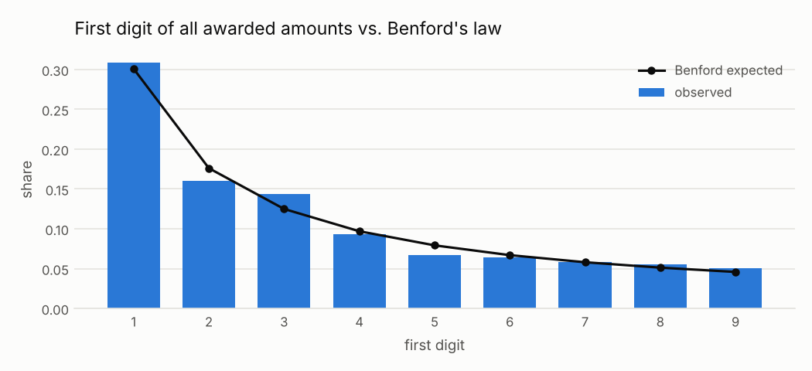
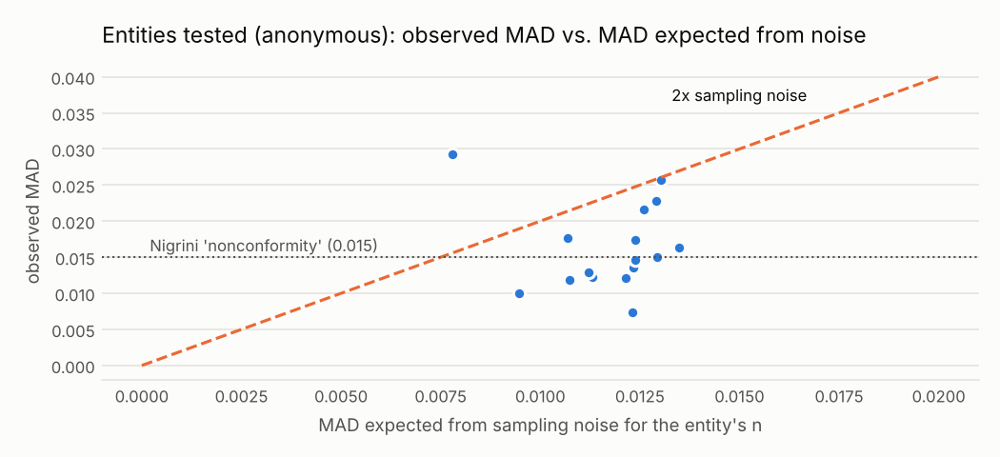

# C08 · Benford's law on awarded amounts (aggregate test)

!!! warning "Signals, never accusations"
    An alert means *"this deserves a review"*, not *"there is an irregularity"*. No supplier,
    official or person is ranked or named; public entities appear only in aggregated views.


| | |
|---|---|
| **Control objective** | The population of awarded amounts of an entity looks like naturally generated amounts. |
| **Risk mitigated** | Systematic fabrication or manipulation of amounts in an entity's records. |
| **Threshold** | MAD > 0.015 (Nigrini nonconformity) and MAD > 2x the sampling-noise MAD for that n |
| **Frequency** | annual |
| **Owner role** | Internal Audit (analytical review) |
| **Evidence generated** | Scope, n, observed vs. expected digit frequencies, MAD, chi-square, conformity class |
| **Level** | aggregate |
| **Weight in risk score** | 0.0 - Aggregate test: excluded from the per-process score by design. |
| **Methodological reference** | Analytical procedure (Nigrini 2012); not an OCP red flag on individual processes |

## Rule

For all awards and for each buyer with at least min_n awards >= min_amount, compare the first-digit distribution with Benford's law using the Mean Absolute Deviation (MAD) and the chi-square statistic. Report Nigrini's conformity class, and flag the scope only when the MAD is also more than excess_ratio times the MAD expected from sampling noise alone for that n (Nigrini's fixed ranges assume large samples; at n = 300 pure noise already gives MAD ~ 0.014). It is a population test only: it never flags an individual process and never enters the risk score.

### Parameters

| parameter | value | unit | origin |
|---|---|---|---|
| min_n | 300.0 | count | catalog literal |
| min_amount | 10.0 | PEN | catalog literal |
| mad_close | 0.006 |  | `thresholds.yaml: benford_mad_first_digit.close` (methodological) |
| mad_acceptable | 0.012 |  | `thresholds.yaml: benford_mad_first_digit.acceptable` (methodological) |
| mad_marginal | 0.015 |  | `thresholds.yaml: benford_mad_first_digit.marginal` (methodological) |
| excess_ratio | 2.0 | x null MAD | catalog literal - MAD beyond 2x its expected value under exact Benford for the same n (~p99.9 by simulation) |

### Expected false positives - high for individual entities (structural reasons are common)

* The 8 UIT minor-purchase limit concentrates amounts in leading digits 3-4
* Entities that buy few kinds of items at fixed prices
* Small populations

## Distribution





Each dot is an entity, unnamed. Dots above the dotted line would be 'nonconforming' under Nigrini's fixed ranges, but most sit below the dashed line: their deviation is what sampling noise produces for that many amounts.

Data behind the chart: `outputs/distributions/c08_distribution.csv`.

## Results of this run

| scope_type | conformity | beyond_sampling_noise | scopes | amounts | mean_mad |
|---|---|---|---|---|---|
| all | acceptable conformity | True | 1 | 12533.0 | 0.0077 |
| buyer | acceptable conformity | False | 3 | 1457.0 | 0.0098 |
| buyer | marginal conformity | False | 5 | 1965.0 | 0.0131 |
| buyer | nonconformity | False | 7 | 2479.0 | 0.0195 |
| buyer | nonconformity | True | 1 | 910.0 | 0.0293 |

## Exact rule (SQL executed by the engine)

```sql
-- C08 Benford's law on awarded amounts - aggregate test, never an individual alert.
-- Output contract (aggregate controls): scope_type, scope_id, n, mad, mad_null, chi2, conformity,
--                                       flag, evidence
-- mad_null = expected MAD under exact Benford for a sample of size n:
--            (1/9) * sum_d sqrt(2 p_d (1 - p_d) / (pi n))
-- flag     = MAD > excess_ratio * mad_null, i.e. beyond what sampling noise explains
--            (excess_ratio 2.0 ~ 99.9th percentile of the null, by simulation; see DECISIONS.md)
WITH digits AS (
    SELECT buyer_id, CAST(left(CAST(CAST(floor(amount) AS BIGINT) AS VARCHAR), 1) AS INTEGER) AS d
    FROM f_award WHERE amount >= $min_amount
),
scoped AS (
    SELECT 'all' AS scope_type, 'all' AS scope_id, d FROM digits
    UNION ALL
    SELECT 'buyer', buyer_id, d FROM digits
),
sizes AS (SELECT scope_type, scope_id, count(*) AS n FROM scoped GROUP BY ALL),
grid AS (
    SELECT s.scope_type, s.scope_id, s.n, g.d, log10(1 + 1.0 / g.d) AS expected
    FROM sizes s CROSS JOIN range(1, 10) g(d)
    WHERE s.n >= $min_n
),
freq AS (
    SELECT g.*, coalesce(c.k, 0) AS observed_n, coalesce(c.k, 0) / g.n AS observed
    FROM grid g
    LEFT JOIN (SELECT scope_type, scope_id, d, count(*) AS k FROM scoped GROUP BY ALL) c
           USING (scope_type, scope_id, d)
)
SELECT scope_type, scope_id, any_value(n) AS n,
       avg(abs(observed - expected)) AS mad,
       avg(sqrt(2 * expected * (1 - expected) / (pi() * n))) AS mad_null,
       sum(power(observed_n - n * expected, 2) / (n * expected)) AS chi2,
       CASE WHEN avg(abs(observed - expected)) <= $mad_close THEN 'close conformity'
            WHEN avg(abs(observed - expected)) <= $mad_acceptable THEN 'acceptable conformity'
            WHEN avg(abs(observed - expected)) <= $mad_marginal THEN 'marginal conformity'
            ELSE 'nonconformity' END AS conformity,
       avg(abs(observed - expected)) > $excess_ratio * avg(sqrt(2 * expected * (1 - expected) / (pi() * n)))
           AS flag,
       to_json(list(struct_pack(digit := d, observed := round(observed, 4),
                                expected := round(expected, 4)) ORDER BY d))::VARCHAR AS evidence
FROM freq
GROUP BY scope_type, scope_id
```
