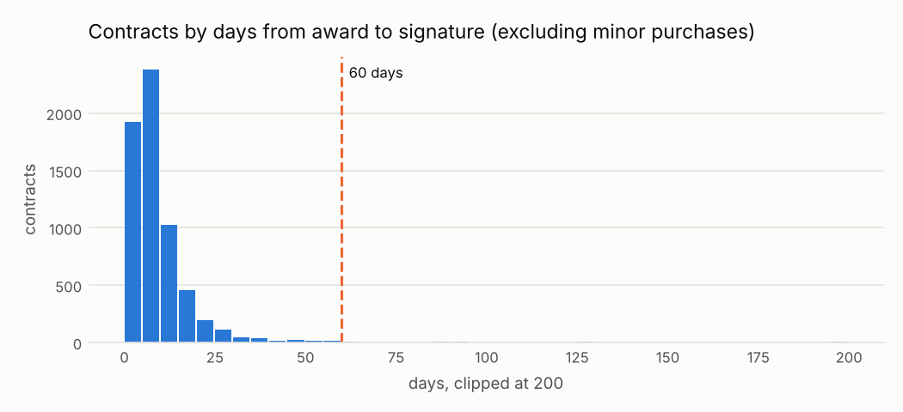

# C09 · Demora inusual entre la adjudicación y la firma del contrato

!!! warning "Signals, never accusations"
    An alert means *"this deserves a review"*, not *"there is an irregularity"*. No supplier,
    official or person is ranked or named; public entities appear only in aggregated views.


| | |
|---|---|
| **Control objective** | Que los contratos se firmen pronto después de la adjudicación, en las condiciones adjudicadas. |
| **Risk mitigated** | Renegociación de condiciones antes de la firma o presión sobre el ganador. |
| **Threshold** | más de 60 días calendario entre la adjudicación y la firma |
| **Frequency** | mensual |
| **Owner role** | Administrador del contrato |
| **Evidence generated** | Proceso, fecha de adjudicación, fecha de firma, días |
| **Level** | process |
| **Weight in risk score** | 0.4 - Clara y barata de revisar, pero las apelaciones son una causa legítima frecuente. |
| **Methodological reference** | OCP Red Flags for Integrity (2016), etapa de adjudicación y contrato: demoras entre la adjudicación y la firma |

## Rule

Para contratos con fecha de firma válida (no anterior a la adjudicación) cuyo procurementMethod no está en excluded_methods, marcar cuando los días entre adjudicación y firma superan max_days.

### Parameters

| parameter | value | unit | origin |
|---|---|---|---|
| max_days | 60 | días | catalog literal - política interna; el plazo legal de firma en días hábiles está por verificar |
| excluded_methods | direct |  | catalog literal - las órdenes de compras menores o directas no tienen paso de firma; agregado tras la revisión de casos (D25) |

### Expected false positives - media (entre 20 y 40 de cada 100 alertas resultan normales)

* Recursos de apelación que suspenden la adjudicación
* Garantías o documentos pendientes del ganador
* Demoras en la certificación presupuestal a fin de año

## Distribution



The long right tail beyond the line is where C09 looks.

Data behind the chart: `outputs/distributions/c09_distribution.csv`.

## Results of this run

| year | alerts | processes | mean_severity |
|---|---|---|---|
| 2024 | 19 | 19 | 0.41 |
| 2025 | 34 | 34 | 0.51 |

### Validation on injected patterns

| injected_pattern | injected | detected | recall | alerts | on_target_pattern | on_other_injected_pattern | on_background | precision_vs_target | background_fp_share | background_alert_rate_pct |
|---|---|---|---|---|---|---|---|---|---|---|
| award_signature_delay | 30 | 30 | 1.0 | 53 | 30 | 1 | 22 | 0.566 | 0.415 | 0.2 |

See [Validation](../validation.md).

## Exact rule (SQL executed by the engine)

```sql
-- C09 Tiempo atípico entre la adjudicación y la firma del contrato.
SELECT c.ocid, c.buyer_id, c.supplier_id, c.year,
       least(1.0, (date_diff('day', CAST(c.award_date AS DATE), CAST(c.date_signed AS DATE)) - $max_days)
                  / (2.0 * $max_days)) AS severity,
       c.method_details AS scope_key,
       to_json(struct_pack(award_date := CAST(c.award_date AS DATE), signed := CAST(c.date_signed AS DATE),
                           days := date_diff('day', CAST(c.award_date AS DATE), CAST(c.date_signed AS DATE)),
                           max_days := $max_days))::VARCHAR AS evidence
FROM f_contract c
JOIN f_process p ON p.ocid = c.ocid
WHERE c.date_signed IS NOT NULL
  AND NOT list_contains($excluded_methods, p.procurement_method)
  AND date_diff('day', CAST(c.award_date AS DATE), CAST(c.date_signed AS DATE)) > $max_days
```
