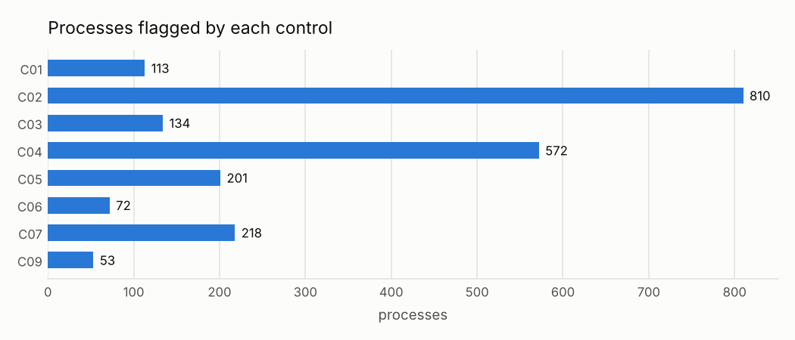

# Peru procurement controls

!!! warning "Signals, never accusations"
    An alert means *"this deserves a review"*, not *"there is an irregularity"*. No supplier,
    official or person is ranked or named; public entities appear only in aggregated views.

!!! info "Data: synthetic (Plan C)"
    The build environment could not reach the OCP Data Registry or the OECE portal, so every
    figure on this site comes from a **seeded synthetic OCDS dataset** with injected, known risk
    patterns. It describes no real entity. The pipeline runs unchanged on the real publications
    (`procontrol run --source oece`).

Continuous-control analytics on Peruvian public procurement, published in the Open Contracting
Data Standard (OCDS). Each control is a written rule with a threshold, an owner role and an
expected false-positive rate, the way an internal-control or continuous-auditing function works.

## At a glance

| | |
|---|---|
| Period | 2024-2025 |
| Contracting processes (clean layer) | 12,554 (5,677 competitive) |
| Awarded amount | S/ 15,624.0 million |
| Public entities (aggregated only) | 40 |
| Controls running | 9 (8 per process, 1 aggregate) |
| Alerts | 2,173 on 1,937 processes (15.4%) |
| Review priority P1 | 178 processes |
| Thresholds still to verify | 8 (listed in `config/thresholds.yaml`) |

Against the injected patterns, the process controls reach a mean recall of **99%**. Their share of alerts on neutral background ranges from **5%** to **82%**: see [Validation](validation.md).

## How to read this site

1. **[Data quality](data-quality.md)** comes first, because a control is only as good as its
   data.
2. **[Control catalog](controls/index.md)** has one page per signal: objective, rule,
   threshold, owner, evidence, expected false positives, the distribution behind it and the
   exact SQL.
3. **[Risk score](risk-score.md)** shows how alerts combine into a review priority.
4. **[Trends](trends.md)** shows how signals move over time, aggregated.
5. **[Validation](validation.md)** shows how well each control finds planted patterns, and a
   blind review of 20 alerts.
6. **[Decisions](metodologia/decisiones.md)** gives every design choice and why.
