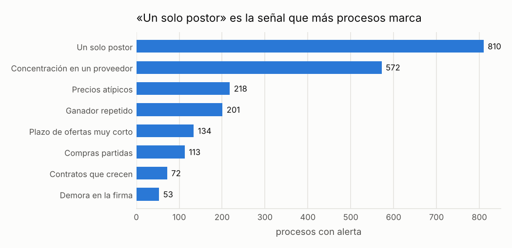

# Controles sobre las compras públicas del Perú

!!! warning "Señales, nunca acusaciones"
    Una alerta significa **«este caso merece revisión»**, no «hay una irregularidad». Este sitio
    no nombra ni ordena a ningún proveedor, funcionario o persona; las entidades públicas solo
    aparecen agrupadas.

!!! note "Datos simulados"
    Todas las cifras de este sitio vienen de **datos simulados**: un conjunto inventado con la
    misma estructura que las compras públicas reales, en el que se sembraron casos de riesgo a
    propósito para comprobar que las señales los encuentran. No describe a ninguna entidad real.
    Cuando corran los datos reales, este aviso cambiará solo.

## Qué es esto

Es un sistema de alertas que revisa las compras del Estado peruano y marca los casos que conviene
mirar con más cuidado: compras partidas para evitar un concurso, concursos con una sola oferta,
contratos que crecen demasiado, precios muy por encima de lo normal, entre otros. Cada alerta
viene con la razón por la que saltó y con lo que un revisor debería pedir primero. Está pensado
para gerentes de logística, de control interno o de administración que necesitan decidir qué
expedientes revisar, sin tener que saber estadística ni programación.

## Una alerta de ejemplo

!!! example "Caso inventado para explicar cómo funciona"
    **Lo que pasó.** Entre el 3 y el 22 de mayo, la *Municipalidad Distrital de Villa Ejemplo
    (entidad inventada)* hizo cinco compras de servicios de transporte a *Transportes Ficticios
    S.A.C. (proveedor inventado)*. Cada una costó entre S/ 36,700 y S/ 40,300, justo debajo de
    S/ 41,200: el monto a partir del cual la ley exige un procedimiento competitivo. Ese monto
    equivale a 8 UIT (Unidad Impositiva Tributaria, un valor de referencia que el Estado fija cada
    año; en 2024 era S/ 5,150).

    **Por qué saltó la señal.** Cinco compras al mismo proveedor, del mismo rubro, en menos de un
    mes y todas pegadas al límite. Juntas suman S/ 192,000, casi cinco veces el límite: si se
    hubieran pedido de una vez, la ley habría exigido un concurso con varios competidores. Por eso
    la señal [compras partidas para no hacer concurso](senales/compras-partidas.md) le dio a cada compra
    prioridad media.

    **Qué haría un revisor.** Pediría los requerimientos de las cinco compras para ver si eran una
    sola necesidad, revisaría quién autorizó cada orden y si hubo cotizaciones de otros
    proveedores. Si era una sola necesidad partida en cinco, es una observación de control. Si
    eran necesidades distintas que surgieron en momentos distintos, archiva la alerta como falsa
    alarma y anota el motivo.

## Las cifras principales

- **Periodo revisado:** de 2024 a 2025 <small>(datos simulados)</small>
- **Procesos de compra revisados:** 12,554, de los cuales 5,677 fueron concursos abiertos <small>(datos simulados)</small>
- **Monto adjudicado:** S/ 15,624.0 millones <small>(datos simulados)</small>
- **Entidades públicas:** 40, que en este sitio solo se muestran agrupadas por tipo <small>(datos simulados)</small>
- **Procesos con al menos una alerta:** 1,937, es decir 15 de cada 100 procesos <small>(datos simulados)</small>
- **Procesos de prioridad alta** (los primeros que conviene revisar): 178 <small>(datos simulados)</small>
- **Señales funcionando:** 8 que revisan cada proceso, más una que revisa el conjunto de montos de cada entidad

*Cómo leerlo:* cada barra es una señal y su largo es la cantidad de procesos que marcó. Que una señal marque muchos procesos no la hace más importante: las más frecuentes suelen ser también las que más falsas alarmas dan, y por eso pesan menos en la prioridad.

## Por dónde seguir

- [Las señales en lenguaje simple](senales/index.md): qué busca cada una, un ejemplo y qué hacer cuando aparece.
- [¿Funciona?](funciona.md): cómo se comprobó que las señales encuentran lo que deben y cuántas falsas alarmas dan.
- [De dónde salen los datos](datos.md): la fuente, su calidad y lo que este proyecto no es.
- [Glosario](glosario.md): cada término y cada sigla explicados con un ejemplo.
- [Metodología](metodologia/index.md): las fórmulas y decisiones, para quien las quiera.
