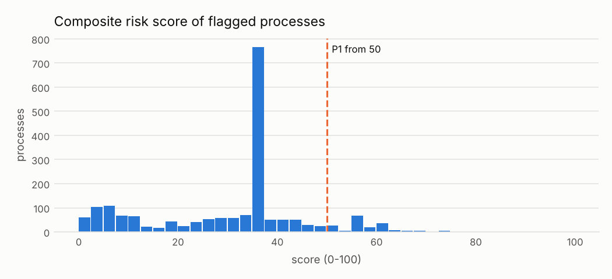

# Composite risk score

!!! warning "Signals, never accusations"
    An alert means *"this deserves a review"*, not *"there is an irregularity"*. No supplier,
    official or person is ranked or named; public entities appear only in aggregated views.

**Formula:** `score = 100 * (1 - PROD_c (1 - weight_c * severity_c))  over the process's alerts`

Each alert is treated as independent evidence that a process deserves a review. The noisy-OR keeps the score between 0 and 100, makes it grow with every additional signal, and saturates instead of adding up linearly, so ten weak signals do not outrank two strong ones. The weight of a control is its specificity: how likely an alert from that control alone is to be worth a reviewer's time, given its expected false-positive profile. The severity (0-1, computed by each rule) is how far past its threshold the case is. Aggregate tests (Benford) never enter the score, because they say nothing about an individual process.

Each rule computes the severity (0-1) as the distance past its threshold. For example, an
amendment at +100% against a 25% cap has severity (1.00 - 0.25) / 0.75 = 1. Only the
strongest alert of each control counts for a process.

## Weights

| control | name | weight | rationale |
|---|---|---|---|
| C01 | Split purchases below the minor-purchase limit | 0.55 | Strong pattern when it fires, but recurring legitimate purchases are common. |
| C02 | Single bidder in a competitive procedure | 0.35 | Very common and often structural; weak evidence on its own, valuable in combination. |
| C03 | Abnormally short submission period | 0.5 | Specific and actionable when the period is checked against the right minimum. |
| C04 | Supplier concentration by entity and category (HHI) | 0.3 | A structural indicator for the cell, not proof about the individual process. |
| C05 | Same winner repeated at the same entity | 0.45 | Uses bid behaviour, not just outcomes; reasonably specific. |
| C06 | Contract amendments raising the amount above the cap | 0.6 | Direct financial impact and a clear legal reference once the cap is verified. |
| C07 | Unit price atypical against the category median | 0.5 | Price is where the money is; heterogeneity of classes limits specificity. |
| C08 | Benford's law on awarded amounts (aggregate test) | 0.0 | Aggregate test: excluded from the per-process score by design. |
| C09 | Atypical time between award and contract signature | 0.4 | Clear and cheap to review, but appeals are a frequent legitimate cause. |

## Review priority

* **P1**: >= 50  - review within the cycle
* **P2**: 25-50 - sample for review
* **P3**: < 25  - monitor only

| priority | processes | mean_score | mean_controls |
|---|---|---|---|
| P1 | 178 | 57.4 | 1.69 |
| P2 | 1205 | 35.4 | 1.09 |
| P3 | 554 | 9.7 | 1.02 |

## Most frequent combinations of signals

Processes where several independent controls fire together are the best use of a reviewer's
time, because each extra signal makes a legitimate explanation less likely.

| controls | processes | mean_score |
|---|---|---|
| C04,C05 | 85 | 49.5 |
| C02,C04 | 24 | 40.5 |
| C02,C07 | 20 | 61.5 |
| C02,C03 | 17 | 51.0 |
| C02,C04,C05 | 13 | 62.1 |
| C01,C04 | 12 | 50.0 |
| C03,C04 | 7 | 34.1 |
| C02,C06 | 6 | 47.3 |
| C04,C07 | 5 | 40.2 |
| C04,C06 | 3 | 30.3 |
| C02,C05 | 3 | 51.0 |
| C05,C06 | 3 | 45.4 |

*The score orders the review queue. It does not measure wrongdoing.*
