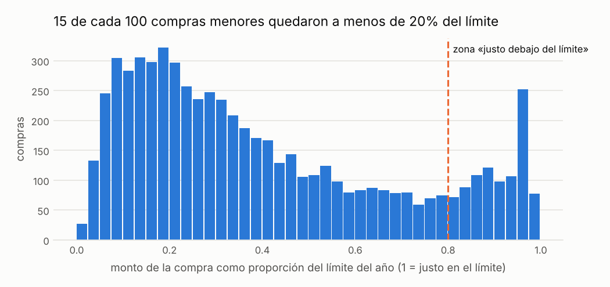

# Compras partidas para no hacer concurso

<small>Señal C01 · responsable sugerido: Responsable de Logística/Abastecimiento, con Control Interno · se revisa con frecuencia mensual</small>

!!! warning "Señales, nunca acusaciones"
    Una alerta significa **«este caso merece revisión»**, no «hay una irregularidad». Este sitio
    no nombra ni ordena a ningún proveedor, funcionario o persona; las entidades públicas solo
    aparecen agrupadas.

!!! note "Datos simulados"
    Todas las cifras de este sitio vienen de **datos simulados**: un conjunto inventado con la
    misma estructura que las compras públicas reales, en el que se sembraron casos de riesgo a
    propósito para comprobar que las señales los encuentran. No describe a ninguna entidad real.
    Cuando corran los datos reales, este aviso cambiará solo.

## Qué busca

Varias compras pequeñas a un mismo proveedor, hechas por la misma entidad en pocos días, cada una justo por debajo del monto a partir del cual la ley exige un concurso.

## Por qué importa

Partir una compra grande en pedazos permite saltarse la competencia y los controles de un procedimiento más exigente. El precio y la elección del proveedor quedan sin contraste.

## Un ejemplo concreto

!!! example "Caso inventado para explicar la señal"
    La Municipalidad de Villa Ejemplo (entidad inventada) compró a Transportes Ficticios S.A.C. (proveedor inventado) cinco servicios de transporte en 20 días, cada uno por unos S/ 39,000, apenas bajo el límite de S/ 41,200 de ese año. Juntos suman S/ 192,000, casi cinco veces el límite: esa compra debió ir a un procedimiento competitivo.

## Cuántas veces apareció

Marcó **113 procesos**, es decir 9 de cada 1,000 procesos revisados <small>(datos simulados)</small>. Por año: 2024: 49; 2025: 64.

En la prueba con casos sembrados, de cada 100 alertas de esta señal unas **7** cayeron en procesos que no tenían nada raro (ver [¿Funciona?](../funciona.md)).



*Cómo leerlo:* cada barra cuenta las compras menores según qué tan cerca quedaron del límite. Las que están a la derecha de la línea naranja quedaron muy cerca. Un montón de compras pegadas al límite no prueba nada por sí solo; la señal salta cuando además se repiten con el mismo proveedor en pocos días. En los datos simulados, el pico en 96-97% es en parte un efecto del generador (ver «De dónde salen los datos»).

## Qué revisar primero

1. ¿La necesidad era previsible desde el inicio (un mismo requerimiento) o surgió en momentos distintos?
2. ¿Quién firmó cada orden y si fue la misma persona?
3. ¿Hubo cotizaciones de otros proveedores en cada compra?

## Cuándo es normal que salte

Estas situaciones disparan la señal sin que haya nada irregular. Antes de escalar una alerta,
descarte cada una:

- Consumibles recurrentes comprados cada mes al proveedor habitual (combustible, alimentos, limpieza)
- Necesidades realmente imprevistas en la misma categoría
- Órdenes de un acuerdo marco publicadas como compras separadas

??? info "Detalle técnico"

    **Regla exacta.** Para un mismo comprador, proveedor y segmento UNSPSC, marcar cada compra menor (no competitiva) cuyo monto esté entre near_limit_ratio × límite y el límite, cuando al menos min_purchases compras así caen dentro de window_days desde la primera y su suma supera el límite del año. El límite es minor_purchase_limit_uit × la UIT del año de la compra.

    **Umbral.** 3 o más compras entre 80% y 100% de 8 UIT, mismo comprador, proveedor y segmento, en 30 días, con suma mayor a 8 UIT

    **Objetivo de control.** Que las compras que por su valor total deberían ir a un procedimiento competitivo no se fragmenten en varias compras menores.

    **Evidencia que genera.** Grupo de compras, procesos que lo forman, fechas, montos, total del grupo frente al límite, segmento UNSPSC

    **Falsas alarmas esperadas (antes de medir).** media-alta (entre 30 y 60 de cada 100 alertas resultan normales)

    **Peso en el puntaje.** 0.55: Patrón fuerte cuando aparece, pero las compras recurrentes legítimas son comunes.

    **Referencia metodológica.** OCP Red Flags for Integrity (2016), etapa de convocatoria: fraccionamiento de contratos para evitar procedimientos competitivos

    **Validación con datos simulados:** casos sembrados 102, encontrados 102; alertas 113, de las cuales 8 cayeron sobre procesos sin patrón sembrado.

    **Parámetros**

    | parámetro | valor | unidad | origen |
    |---|---|---|---|
    | `limit_uit` | 8 | UIT | `thresholds.yaml: minor_purchase_limit_uit.value` |
    | `near_limit_ratio` | 0.8 | proporción | valor del catálogo (política interna: «justo debajo» = el 20% superior de la banda) |
    | `window_days` | 30 | días | valor del catálogo (política interna: un ciclo mensual de compras) |
    | `min_purchases` | 3 | cantidad | valor del catálogo |
    | `minor_methods` | direct |  | valor del catálogo (valores de procurementMethod de OCDS tratados como compras menores o directas) |

    **Consulta SQL que ejecuta el motor** (`controls/sql/c01_split_purchases.sql`)

    ```sql
    -- C01 Compras partidas debajo del límite de compra menor.
    -- Columnas de salida (controles por proceso): ocid, buyer_id, supplier_id, year, severity, scope_key, evidence
    WITH near AS (
        SELECT a.ocid, a.buyer_id, a.supplier_id, a.segment, a.year,
               CAST(a.award_date AS DATE) AS d, a.amount, r.limit_pen
        FROM f_award a
        JOIN ref_minor_limit r ON r.year = a.year
        WHERE list_contains($minor_methods, a.procurement_method)
          AND a.amount IS NOT NULL
          AND a.amount <= r.limit_pen
          AND a.amount >= $near_limit_ratio * r.limit_pen
    ),
    clusters AS (
        -- cada compra cercana al límite abre una ventana; los miembros son las compras dentro de ella
        SELECT x.ocid AS anchor, x.buyer_id, x.supplier_id, x.segment, x.year, x.d AS start_date,
               max(x.limit_pen) AS limit_pen, count(*) AS n, sum(y.amount) AS total,
               list(y.ocid ORDER BY y.d, y.ocid) AS members,
               list(y.amount ORDER BY y.d, y.ocid) AS amounts
        FROM near x
        JOIN near y
          ON y.buyer_id = x.buyer_id AND y.supplier_id = x.supplier_id AND y.segment = x.segment
         AND y.d BETWEEN x.d AND x.d + CAST($window_days AS INTEGER)
        GROUP BY ALL
        HAVING count(*) >= $min_purchases AND sum(y.amount) > max(x.limit_pen)
    ),
    flagged AS (
        SELECT unnest(members) AS ocid, c.*
        FROM clusters c
    )
    SELECT f.ocid, f.buyer_id, f.supplier_id, f.year,
           least(1.0, arg_max(f.n, f.n) / 5.0) AS severity,
           arg_max(f.buyer_id || '|' || f.supplier_id || '|' || f.segment || '|' || f.start_date, f.n) AS scope_key,
           to_json(arg_max(struct_pack(
               n_purchases := f.n, cluster_total := round(f.total, 2), limit_pen := f.limit_pen,
               total_vs_limit := round(f.total / f.limit_pen, 2), window_start := f.start_date,
               segment := f.segment, members := f.members, amounts := f.amounts), f.n))::VARCHAR AS evidence
    FROM flagged f
    GROUP BY f.ocid, f.buyer_id, f.supplier_id, f.year
    ```

