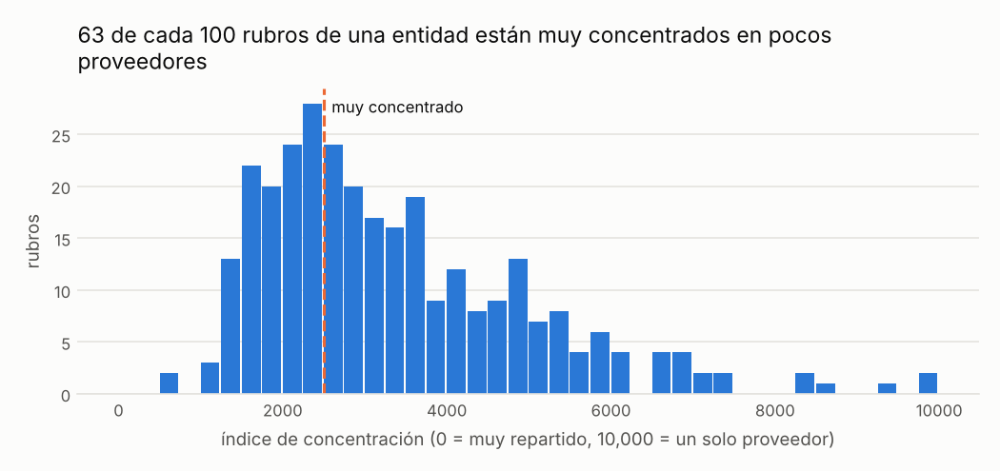

# Un proveedor concentra las compras de una entidad

<small>Señal C04 · responsable sugerido: Responsable de la categoría de compra; Control Interno · se revisa con frecuencia trimestral</small>

!!! warning "Señales, nunca acusaciones"
    Una alerta significa **«este caso merece revisión»**, no «hay una irregularidad». Este sitio
    no nombra ni ordena a ningún proveedor, funcionario o persona; las entidades públicas solo
    aparecen agrupadas.

!!! note "Datos simulados"
    Todas las cifras de este sitio vienen de **datos simulados**: un conjunto inventado con la
    misma estructura que las compras públicas reales, en el que se sembraron casos de riesgo a
    propósito para comprobar que las señales los encuentran. No describe a ninguna entidad real.
    Cuando corran los datos reales, este aviso cambiará solo.

## Qué busca

Entidades en las que, para un tipo de bien o servicio y en un año, casi todo el dinero se lo lleva un mismo proveedor, y no por un único contrato grande sino por muchos.

## Por qué importa

Cuando un proveedor domina un rubro, la entidad pierde poder de negociación y aumenta el riesgo de favoritismo o de dependencia.

## Un ejemplo concreto

!!! example "Caso inventado para explicar la señal"
    En 2025, la Municipalidad de Villa Ejemplo (entidad inventada) contrató 33 servicios de transporte; 29 fueron para Transportes Ficticios S.A.C. (proveedor inventado), que se llevó 92 de cada 100 soles gastados en ese rubro.

## Cuántas veces apareció

Marcó **572 procesos**, es decir 5 de cada 100 procesos revisados <small>(datos simulados)</small>. Por año: 2024: 339; 2025: 233.

En la prueba con casos sembrados, de cada 100 alertas de esta señal unas **68** cayeron en procesos que no tenían nada raro (ver [¿Funciona?](../funciona.md)).



*Cómo leerlo:* cada barra cuenta rubros (un tipo de compra de una entidad en un año) según qué tan concentrado está el gasto. A la derecha de la línea, pocos proveedores se llevan casi todo. Muchos rubros quedan ahí por un solo contrato grande; por eso la señal exige además que el proveedor principal tenga varios contratos.

## Qué revisar primero

1. ¿Hay pocos proveedores en la zona o es un distribuidor exclusivo?
2. ¿Los demás postores fueron descalificados? ¿Por qué motivos?
3. ¿El proveedor dominante gana también en otras entidades cercanas?

## Cuándo es normal que salte

Estas situaciones disparan la señal sin que haya nada irregular. Antes de escalar una alerta,
descarte cada una:

- Monopolios naturales o distribuidores exclusivos (medicinas con patente, servicios públicos)
- Celdas pequeñas, cerca del mínimo
- Pocos proveedores en zonas alejadas

??? info "Detalle técnico"

    **Regla exacta.** Para cada comprador × segmento UNSPSC × año con al menos min_awards adjudicaciones con monto utilizable, calcular el índice HHI = suma sobre proveedores de (participación en el monto × 100)². Si el HHI supera hhi_threshold y el proveedor con mayor participación tiene al menos min_top_awards adjudicaciones en la celda, marcar los procesos adjudicados a ese proveedor.

    **Umbral.** HHI mayor a 2,500, con 15 o más adjudicaciones en la celda y 3 o más del proveedor principal

    **Objetivo de control.** Que el gasto de cada entidad y categoría no quede capturado por un proveedor.

    **Evidencia que genera.** Celda (comprador-segmento-año), HHI, número de adjudicaciones y proveedores, participación del principal

    **Falsas alarmas esperadas (antes de medir).** media-alta (entre 30 y 60 de cada 100 alertas resultan normales)

    **Peso en el puntaje.** 0.3: Indicador estructural de la celda, no prueba sobre el proceso individual.

    **Referencia metodológica.** OCP Red Flags for Integrity (2016): concentración de mercado o dominio de un proveedor (sin código Cardinal asignado)

    **Validación con datos simulados:** casos sembrados 143, encontrados 143; alertas 572, de las cuales 392 cayeron sobre procesos sin patrón sembrado.

    **Parámetros**

    | parámetro | valor | unidad | origen |
    |---|---|---|---|
    | `hhi_threshold` | 2500 | puntos HHI (0 a 10,000) | `thresholds.yaml: hhi_highly_concentrated.value` |
    | `min_awards` | 15 | cantidad | valor del catálogo (por debajo de esto el HHI sale alto por construcción) |
    | `min_top_awards` | 3 | cantidad | valor del catálogo (el dominio debe venir de varias adjudicaciones, no de un contrato grande) |

    **Consulta SQL que ejecuta el motor** (`controls/sql/c04_supplier_concentration.sql`)

    ```sql
    -- C04 Concentración de proveedores por entidad y categoría (HHI sobre el monto adjudicado).
    WITH by_supplier AS (
        SELECT buyer_id, segment, year, supplier_id, sum(amount) AS amt, count(*) AS n
        FROM f_award WHERE amount IS NOT NULL
        GROUP BY ALL
    ),
    hhi AS (
        SELECT b.buyer_id, b.segment, b.year,
               sum(power(100.0 * b.amt / t.total, 2)) AS hhi,
               any_value(t.total) AS total, any_value(t.n_awards) AS n_awards, count(*) AS n_suppliers,
               arg_max(b.supplier_id, b.amt) AS top_supplier, arg_max(b.n, b.amt) AS top_awards, max(b.amt) / any_value(t.total) AS top_share
        FROM by_supplier b
        JOIN (SELECT buyer_id, segment, year, sum(amt) AS total, sum(n) AS n_awards
              FROM by_supplier GROUP BY ALL) t USING (buyer_id, segment, year)
        GROUP BY ALL
    )
    SELECT a.ocid, a.buyer_id, a.supplier_id, a.year,
           (h.hhi - $hhi_threshold) / (10000.0 - $hhi_threshold) AS severity,
           h.buyer_id || '|' || h.segment || '|' || h.year AS scope_key,
           to_json(struct_pack(segment := h.segment, hhi := round(h.hhi, 0), n_awards := h.n_awards,
                               n_suppliers := h.n_suppliers, top_supplier_share := round(h.top_share, 3), top_supplier_awards := h.top_awards,
                               cell_total := round(h.total, 2)))::VARCHAR AS evidence
    FROM hhi h
    JOIN f_award a ON a.buyer_id = h.buyer_id AND a.segment = h.segment AND a.year = h.year
                  AND a.supplier_id = h.top_supplier AND a.amount IS NOT NULL
    WHERE h.n_awards >= $min_awards AND h.hhi > $hhi_threshold AND h.top_awards >= $min_top_awards
    ```

