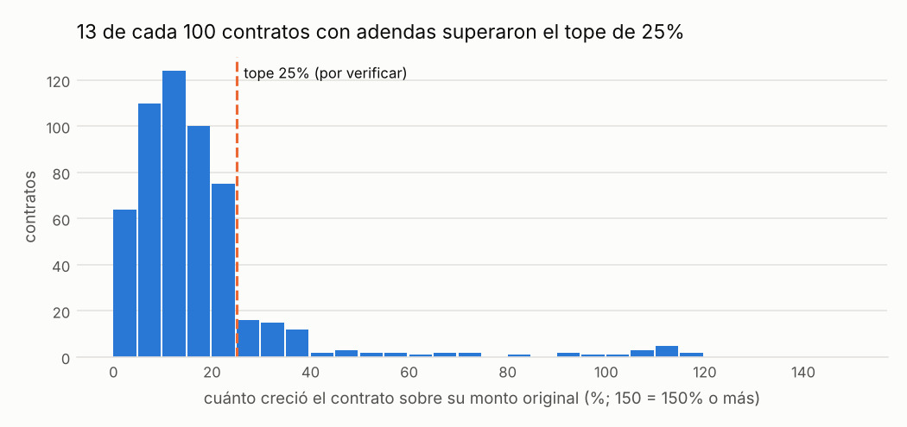

# Contratos que crecen demasiado después de firmados

<small>Señal C06 · responsable sugerido: Administrador del contrato; Control Interno · se revisa con frecuencia mensual</small>

!!! warning "Señales, nunca acusaciones"
    Una alerta significa **«este caso merece revisión»**, no «hay una irregularidad». Este sitio
    no nombra ni ordena a ningún proveedor, funcionario o persona; las entidades públicas solo
    aparecen agrupadas.

!!! note "Datos simulados"
    Todas las cifras de este sitio vienen de **datos simulados**: un conjunto inventado con la
    misma estructura que las compras públicas reales, en el que se sembraron casos de riesgo a
    propósito para comprobar que las señales los encuentran. No describe a ninguna entidad real.
    Cuando corran los datos reales, este aviso cambiará solo.

## Qué busca

Contratos cuyo monto subió con modificaciones posteriores (adendas) más allá del límite que la ley permite sin un nuevo proceso.

## Por qué importa

Una forma de ganar un concurso es ofrecer barato y recuperar después con modificaciones. También puede ser trabajo nuevo que debió concursarse aparte.

## Un ejemplo concreto

!!! example "Caso inventado para explicar la señal"
    El Gobierno Regional de Ejemplo (entidad inventada) firmó con Consultora Ficticia S.A.C. (proveedor inventado) un contrato de S/ 234,000. Con dos adendas llegó a S/ 500,000: creció 114%, cuando el límite es 25%. Además, en ese concurso hubo un solo postor.

## Cuántas veces apareció

Marcó **72 procesos**, es decir 6 de cada 1,000 procesos revisados <small>(datos simulados)</small>. Por año: 2024: 33; 2025: 39.

En la prueba con casos sembrados, de cada 100 alertas de esta señal unas **49** cayeron en procesos que no tenían nada raro (ver [¿Funciona?](../funciona.md)).



*Cómo leerlo:* cada barra cuenta los contratos modificados según cuánto creció su monto. A la derecha de la línea están los que pasaron el tope.

## Qué revisar primero

1. ¿Las adendas tienen la resolución de aprobación y el informe técnico que las justifica?
2. ¿Son obras adicionales (con reglas distintas) o reajustes de precios por fórmula?
3. ¿El monto original estaba muy por debajo de lo que la entidad había estimado?

## Cuándo es normal que salte

Estas situaciones disparan la señal sin que haya nada irregular. Antes de escalar una alerta,
descarte cada una:

- Adicionales de obra aprobados (las obras tienen límites distintos)
- Reajustes de precio por fórmula publicados como modificaciones
- Monto modificado publicado con impuestos cuando el original no los incluía

??? info "Detalle técnico"

    **Regla exacta.** Para cada contrato con modificaciones que publican un monto total actualizado, calcular aumento = último monto modificado / monto original − 1 y marcar cuando supera cap.

    **Umbral.** aumento acumulado mayor a 25% (por verificar bajo la Ley 32069)

    **Objetivo de control.** Que las modificaciones no superen los límites que justificó la competencia original.

    **Evidencia que genera.** Proceso, contrato, monto original, monto modificado, % de aumento, número de modificaciones

    **Falsas alarmas esperadas (antes de medir).** media (entre 20 y 40 de cada 100 alertas resultan normales)

    **Peso en el puntaje.** 0.6: Impacto económico directo y referencia legal clara una vez verificado el tope.

    **Referencia metodológica.** OCP Red Flags for Integrity (2016), etapa de ejecución: modificaciones contractuales y sobrecostos

    **Validación con datos simulados:** casos sembrados 30, encontrados 30; alertas 72, de las cuales 35 cayeron sobre procesos sin patrón sembrado.

    **Parámetros**

    | parámetro | valor | unidad | origen |
    |---|---|---|---|
    | `cap` | 0.25 | proporción | `thresholds.yaml: amendment_increase_cap.value` |

    **Consulta SQL que ejecuta el motor** (`controls/sql/c06_amendment_increase.sql`)

    ```sql
    -- C06 Modificaciones contractuales que suben el monto por encima del tope.
    SELECT c.ocid, c.buyer_id, c.supplier_id, c.year,
           least(1.0, (c.final_amount / c.original_amount - 1 - $cap) / (1 - $cap)) AS severity,
           c.contract_id AS scope_key,
           to_json(struct_pack(contract_id := c.contract_id, original_amount := c.original_amount,
                               amended_amount := c.final_amount,
                               increase_pct := round(100 * (c.final_amount / c.original_amount - 1), 1),
                               n_amendments := c.n_amendments))::VARCHAR AS evidence
    FROM f_contract c
    WHERE c.final_amount IS NOT NULL AND c.original_amount > 0
      AND c.final_amount / c.original_amount - 1 > $cap
    ```

