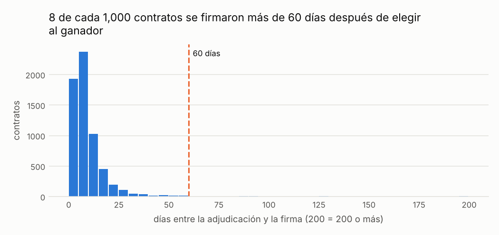

# Demora inusual entre la adjudicación y la firma del contrato

<small>Señal C09 · responsable sugerido: Administrador del contrato · se revisa con frecuencia mensual</small>

!!! warning "Señales, nunca acusaciones"
    Una alerta significa **«este caso merece revisión»**, no «hay una irregularidad». Este sitio
    no nombra ni ordena a ningún proveedor, funcionario o persona; las entidades públicas solo
    aparecen agrupadas.

!!! note "Datos simulados"
    Todas las cifras de este sitio vienen de **datos simulados**: un conjunto inventado con la
    misma estructura que las compras públicas reales, en el que se sembraron casos de riesgo a
    propósito para comprobar que las señales los encuentran. No describe a ninguna entidad real.
    Cuando corran los datos reales, este aviso cambiará solo.

## Qué busca

Contratos que se firmaron mucho tiempo después de que se eligió al ganador.

## Por qué importa

Entre la adjudicación y la firma se pueden renegociar en privado las condiciones que se ganaron en público, o presionar al ganador.

## Un ejemplo concreto

!!! example "Caso inventado para explicar la señal"
    La Universidad Nacional de Ejemplo (entidad inventada) adjudicó un servicio de ingeniería a Ingenieros Ficticios S.A.C. (proveedor inventado) en agosto, pero el contrato se firmó a fines de diciembre: 126 días después, cuando lo habitual son menos de dos semanas.

## Cuántas veces apareció

Marcó **53 procesos**, es decir 4 de cada 1,000 procesos revisados <small>(datos simulados)</small>. Por año: 2024: 19; 2025: 34.

En la prueba con casos sembrados, de cada 100 alertas de esta señal unas **42** cayeron en procesos que no tenían nada raro (ver [¿Funciona?](../funciona.md)).



*Cómo leerlo:* cada barra cuenta los contratos según cuántos días pasaron entre la adjudicación y la firma. La mayoría se firma en pocos días; la cola a la derecha de la línea es lo que la señal revisa.

## Qué revisar primero

1. ¿Hubo un recurso de apelación que suspendió el proceso?
2. ¿El ganador tardó en presentar garantías o documentos?
3. ¿Las condiciones firmadas son las mismas que las de la oferta ganadora?

## Cuándo es normal que salte

Estas situaciones disparan la señal sin que haya nada irregular. Antes de escalar una alerta,
descarte cada una:

- Recursos de apelación que suspenden la adjudicación
- Garantías o documentos pendientes del ganador
- Demoras en la certificación presupuestal a fin de año

??? info "Detalle técnico"

    **Regla exacta.** Para contratos con fecha de firma válida (no anterior a la adjudicación) cuyo procurementMethod no está en excluded_methods, marcar cuando los días entre adjudicación y firma superan max_days.

    **Umbral.** más de 60 días calendario entre la adjudicación y la firma

    **Objetivo de control.** Que los contratos se firmen pronto después de la adjudicación, en las condiciones adjudicadas.

    **Evidencia que genera.** Proceso, fecha de adjudicación, fecha de firma, días

    **Falsas alarmas esperadas (antes de medir).** media (entre 20 y 40 de cada 100 alertas resultan normales)

    **Peso en el puntaje.** 0.4: Clara y barata de revisar, pero las apelaciones son una causa legítima frecuente.

    **Referencia metodológica.** OCP Red Flags for Integrity (2016), etapa de adjudicación y contrato: demoras entre la adjudicación y la firma

    **Validación con datos simulados:** casos sembrados 30, encontrados 30; alertas 53, de las cuales 22 cayeron sobre procesos sin patrón sembrado.

    **Parámetros**

    | parámetro | valor | unidad | origen |
    |---|---|---|---|
    | `max_days` | 60 | días | valor del catálogo (política interna; el plazo legal de firma en días hábiles está por verificar) |
    | `excluded_methods` | direct |  | valor del catálogo (las órdenes de compras menores o directas no tienen paso de firma; agregado tras la revisión de casos (D25)) |

    **Consulta SQL que ejecuta el motor** (`controls/sql/c09_award_signature_delay.sql`)

    ```sql
    -- C09 Tiempo atípico entre la adjudicación y la firma del contrato.
    SELECT c.ocid, c.buyer_id, c.supplier_id, c.year,
           least(1.0, (date_diff('day', CAST(c.award_date AS DATE), CAST(c.date_signed AS DATE)) - $max_days)
                      / (2.0 * $max_days)) AS severity,
           c.method_details AS scope_key,
           to_json(struct_pack(award_date := CAST(c.award_date AS DATE), signed := CAST(c.date_signed AS DATE),
                               days := date_diff('day', CAST(c.award_date AS DATE), CAST(c.date_signed AS DATE)),
                               max_days := $max_days))::VARCHAR AS evidence
    FROM f_contract c
    JOIN f_process p ON p.ocid = c.ocid
    WHERE c.date_signed IS NOT NULL
      AND NOT list_contains($excluded_methods, p.procurement_method)
      AND date_diff('day', CAST(c.award_date AS DATE), CAST(c.date_signed AS DATE)) > $max_days
    ```

