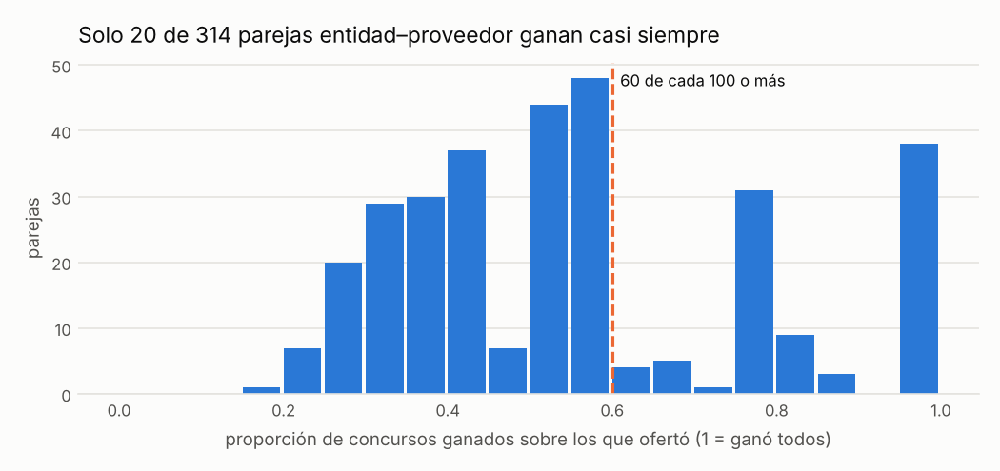

# El mismo ganador una y otra vez en la misma entidad

<small>Señal C05 · responsable sugerido: Control Interno; Responsable de Logística · se revisa con frecuencia trimestral</small>

!!! warning "Señales, nunca acusaciones"
    Una alerta significa **«este caso merece revisión»**, no «hay una irregularidad». Este sitio
    no nombra ni ordena a ningún proveedor, funcionario o persona; las entidades públicas solo
    aparecen agrupadas.

!!! note "Datos simulados"
    Todas las cifras de este sitio vienen de **datos simulados**: un conjunto inventado con la
    misma estructura que las compras públicas reales, en el que se sembraron casos de riesgo a
    propósito para comprobar que las señales los encuentran. No describe a ninguna entidad real.
    Cuando corran los datos reales, este aviso cambiará solo.

## Qué busca

Un proveedor que, en una misma entidad y en un mismo año, gana casi todos los concursos a los que se presenta.

## Por qué importa

Ganar siempre puede ser señal de eficiencia, pero también de acuerdos entre postores (se turnan para ganar) o de un comité de evaluación que favorece a alguien.

## Un ejemplo concreto

!!! example "Caso inventado para explicar la señal"
    En 2024, Sistemas Ficticios S.A. (proveedor inventado) se presentó a 14 concursos de la Universidad Nacional de Ejemplo (entidad inventada) y ganó los 14.

## Cuántas veces apareció

Marcó **201 procesos**, es decir 2 de cada 100 procesos revisados <small>(datos simulados)</small>. Por año: 2024: 136; 2025: 65.

En la prueba con casos sembrados, de cada 100 alertas de esta señal unas **19** cayeron en procesos que no tenían nada raro (ver [¿Funciona?](../funciona.md)).



*Cómo leerlo:* cada barra cuenta parejas de una entidad y un proveedor que ganó al menos 3 concursos en un año, según la proporción de concursos que ganó. La señal salta a la derecha de la línea cuando además ganó 6 o más.

## Qué revisar primero

1. ¿Quiénes fueron los otros postores y por qué perdieron (precio, descalificación)?
2. ¿Los mismos competidores aparecen siempre y pierden siempre?
3. ¿Los integrantes del comité de evaluación se repiten?

## Cuándo es normal que salte

Estas situaciones disparan la señal sin que haya nada irregular. Antes de escalar una alerta,
descarte cada una:

- Un proveedor local eficiente con los precios más bajos
- Datos de ofertas incompletos (si no se publican las ofertas perdedoras, la tasa de éxito parece mayor)

??? info "Detalle técnico"

    **Regla exacta.** Para cada comprador × proveedor × año, entre procesos competitivos, contar victorias y procesos en que el proveedor ofertó. Marcar los procesos ganados cuando victorias ≥ min_wins y victorias / ofertas ≥ min_win_rate.

    **Umbral.** 6 o más victorias en un año en una entidad, ganando al menos 60 de cada 100 veces

    **Objetivo de control.** Que los concursos de una entidad se repartan según las condiciones del mercado.

    **Evidencia que genera.** Comprador-proveedor-año, victorias, ofertas presentadas, tasa de éxito, procesos ganados

    **Falsas alarmas esperadas (antes de medir).** media (entre 25 y 50 de cada 100 alertas resultan normales)

    **Peso en el puntaje.** 0.45: Usa el comportamiento de las ofertas, no solo los resultados; razonablemente específica.

    **Referencia metodológica.** OCP Red Flags for Integrity (2016): el mismo proveedor gana repetidamente (sin código Cardinal asignado)

    **Validación con datos simulados:** casos sembrados 89, encontrados 89; alertas 201, de las cuales 38 cayeron sobre procesos sin patrón sembrado.

    **Parámetros**

    | parámetro | valor | unidad | origen |
    |---|---|---|---|
    | `min_wins` | 6.0 | cantidad | valor del catálogo |
    | `min_win_rate` | 0.6 | proporción | valor del catálogo (bajó de 0.80 tras la primera corrida simulada, ver D19) |

    **Consulta SQL que ejecuta el motor** (`controls/sql/c05_repeated_winner.sql`)

    ```sql
    -- C05 El mismo ganador repetido en la misma entidad (procesos competitivos).
    WITH bids AS (
        SELECT buyer_id, supplier_id, year, count(DISTINCT ocid) AS n_bids
        FROM f_bid WHERE is_competitive GROUP BY ALL
    ),
    wins AS (
        SELECT buyer_id, supplier_id, year, count(DISTINCT ocid) AS n_wins,
               list(DISTINCT ocid) AS won
        FROM f_award WHERE is_competitive GROUP BY ALL
    ),
    pairs AS (
        SELECT w.*, greatest(b.n_bids, w.n_wins) AS n_bids,
               w.n_wins / greatest(b.n_bids, w.n_wins) AS win_rate
        FROM wins w LEFT JOIN bids b USING (buyer_id, supplier_id, year)
        WHERE w.n_wins >= $min_wins
    )
    SELECT unnest(p.won) AS ocid, p.buyer_id, p.supplier_id, p.year,
           p.win_rate * least(1.0, p.n_wins / (2.0 * $min_wins)) AS severity,
           p.buyer_id || '|' || p.supplier_id || '|' || p.year AS scope_key,
           to_json(struct_pack(wins := p.n_wins, bids := p.n_bids,
                               win_rate := round(p.win_rate, 3)))::VARCHAR AS evidence
    FROM pairs p
    WHERE p.win_rate >= $min_win_rate
    ```

