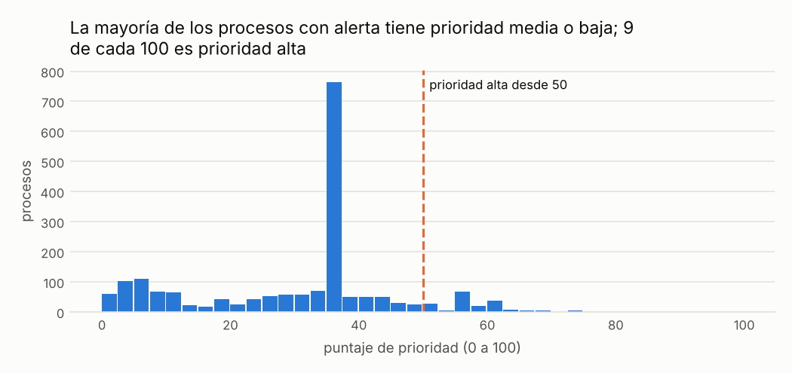
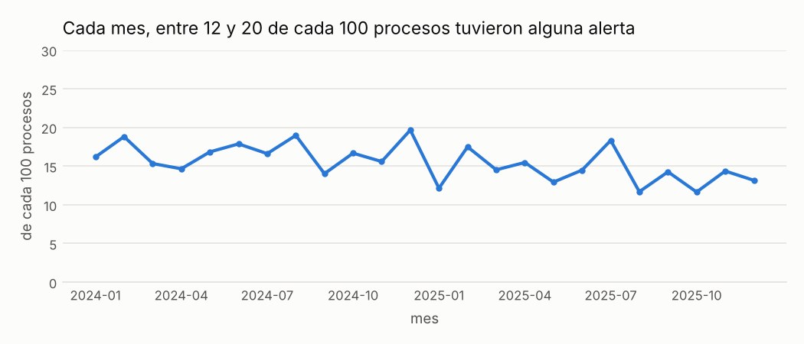

# Las señales en lenguaje simple

!!! warning "Señales, nunca acusaciones"
    Una alerta significa **«este caso merece revisión»**, no «hay una irregularidad». Este sitio
    no nombra ni ordena a ningún proveedor, funcionario o persona; las entidades públicas solo
    aparecen agrupadas.

!!! note "Datos simulados"
    Todas las cifras de este sitio vienen de **datos simulados**: un conjunto inventado con la
    misma estructura que las compras públicas reales, en el que se sembraron casos de riesgo a
    propósito para comprobar que las señales los encuentran. No describe a ninguna entidad real.
    Cuando corran los datos reales, este aviso cambiará solo.

Cada señal es una regla escrita que revisa todos los procesos de compra y marca los que se salen
de lo normal en un aspecto concreto. Ninguna prueba que haya algo irregular: indica dónde conviene
mirar primero.

| Señal | Qué riesgo busca | Ejemplo | Qué tan seguido es falsa alarma* | Qué hacer cuando aparece |
|---|---|---|---|---|
| [Compras partidas para no hacer concurso](compras-partidas.md) <small>C01</small> | Evitar la competencia y los controles de un procedimiento más exigente partiendo un requerimiento en compras justo debajo del límite de compra menor de 8 UIT (Unidad Impositiva Tributaria). | Cinco compras de S/ 39,000 al mismo proveedor en 20 días, con un límite de S/ 41,200. | 7 de cada 100 alertas | Pedir los requerimientos originales y ver si eran una sola necesidad. |
| [Un solo postor en un concurso abierto](un-solo-postor.md) <small>C02</small> | Especificaciones restrictivas, poca difusión o colusión que dejan un solo postor y eliminan la disciplina de precios. | Una compra de papel, que venden decenas de empresas, recibió una sola oferta. | 82 de cada 100 alertas | Revisar solo si coincide con otra señal o si la entidad tiene más casos que el promedio nacional. |
| [Plazo demasiado corto para presentar ofertas](plazo-corto.md) <small>C03</small> | Un plazo demasiado corto para competir, que favorece a un postor que sabía de antemano. | Una licitación de equipos de cómputo con 3 días para ofertar, cuando el mínimo es 22. | 52 de cada 100 alertas | Pedir la justificación del plazo y la lista de quienes descargaron las bases. |
| [Un proveedor concentra las compras de una entidad](concentracion.md) <small>C04</small> | Captura de un rubro por un proveedor, favoritismo, dependencia. | Un proveedor se llevó 29 de 33 contratos de transporte de una entidad en un año. | 68 de cada 100 alertas | Revisar el rubro completo con el responsable de la categoría, no un contrato aislado. |
| [El mismo ganador una y otra vez en la misma entidad](ganador-repetido.md) <small>C05</small> | Colusión entre postores (rotación u ofertas de cobertura), favoritismo del comité. | Un proveedor se presentó a 14 concursos de una entidad en un año y ganó los 14. | 19 de cada 100 alertas | Comparar las ofertas perdedoras: precios casi iguales o descalificaciones repetidas merecen atención. |
| [Contratos que crecen demasiado después de firmados](contratos-que-crecen.md) <small>C06</small> | Una oferta baja recuperada después con adendas, o trabajo nuevo sin un nuevo procedimiento. | Un contrato de S/ 234,000 terminó en S/ 500,000 tras dos adendas. | 49 de cada 100 alertas | Pedir las resoluciones de aprobación de cada adenda. |
| [Precios muy por encima de lo que pagan otros](precios-atipicos.md) <small>C07</small> | Sobreprecios, especificaciones infladas o errores de unidad o cantidad que los esconden. | Un kilo de alimentos pagado a S/ 102.60 cuando lo típico es S/ 16.80. | 5 de cada 100 alertas | Pedir el estudio de mercado que sustentó el valor estimado. |
| [Montos que no parecen naturales (ley de Benford)](montos-poco-naturales.md) <small>C08</small> | Fabricación o manipulación sistemática de montos en los registros de una entidad. | Solo 11 de cada 100 montos empiezan con 1, cuando lo esperado es 30. | No aplica: revisa el conjunto de montos de cada entidad, no procesos | Usarla como señal para planificar una auditoría, nunca como hallazgo sobre un contrato. |
| [Demora inusual entre la adjudicación y la firma del contrato](demora-en-la-firma.md) <small>C09</small> | Renegociación de condiciones antes de la firma o presión sobre el ganador. | Un contrato firmado 126 días después de elegir al ganador. | 42 de cada 100 alertas | Revisar si hubo apelación; si no la hubo, comparar el contrato con la oferta. |

\* Medido con los casos sembrados en los datos simulados: de cada 100 alertas de la señal, cuántas
cayeron en procesos que no tenían nada raro. Ver [¿Funciona?](../funciona.md).

## Cómo se decide qué revisar primero

Un proceso puede tener varias señales a la vez. Cada señal suma a un puntaje de 0 a 100: las
señales que casi nunca se equivocan suman más y las que dan muchas falsas alarmas suman menos.
Varias señales juntas suben mucho el puntaje, porque es poco probable que todas tengan una
explicación inocente a la vez.

| Prioridad | Puntaje | Qué hacer | Procesos <small>(datos simulados)</small> |
|---|---|---|---|
| Alta | >= 50 | revisar dentro del ciclo | 178 |
| Media | 25-50 | revisar una muestra | 1,205 |
| Baja | < 25 | solo seguimiento | 554 |

*Cómo leerlo:* cada barra cuenta los procesos con alerta según su puntaje. A la derecha de la línea están los de prioridad alta.

## Dónde y cuándo aparecen las alertas

*Cómo leerlo:* cada punto es un mes y su altura indica, de cada 100 procesos de ese mes, cuántos tuvieron al menos una alerta. Una subida brusca en un mes merece una pregunta: ¿cambió algo en la forma de comprar o en la publicación de los datos?

### Por tipo de entidad

Las entidades se agrupan por tipo; nunca se muestra una entidad individual. Los grupos con menos de
3 entidades se suman a «Otras entidades» para que ninguna se pueda reconocer.

| Tipo de entidad | Entidades | Procesos | Con alerta |
|---|---|---|---|
| Universidades | 5 | 2,034 | 21 de cada 100 |
| Ministerios | 5 | 1,467 | 17 de cada 100 |
| Unidades ejecutoras | 5 | 1,603 | 16 de cada 100 |
| Gobiernos regionales | 5 | 1,330 | 16 de cada 100 |
| Hospitales | 5 | 1,462 | 14 de cada 100 |
| Municipalidades provinciales | 5 | 1,911 | 13 de cada 100 |
| Organismos reguladores y supervisores | 5 | 1,494 | 13 de cada 100 |
| Municipalidades distritales | 5 | 1,253 | 12 de cada 100 |

### Por tipo de proceso

| Tipo de proceso | Procesos | Con alerta |
|---|---|---|
| compra directa o menor | 6,263 | 7 de cada 100 |
| procedimiento abierto | 5,677 | 26 de cada 100 |
| contratación directa | 614 | 8 de cada 100 |

### Por rubro

Rubros con al menos 30 procesos, ordenados de mayor a menor proporción de alertas.

| Rubro | Procesos | Con alerta |
|---|---|---|
| Obras de construcción | 826 | 23 de cada 100 |
| Combustibles y lubricantes | 678 | 21 de cada 100 |
| Servicios de ingeniería | 954 | 20 de cada 100 |
| Servicios de limpieza | 573 | 16 de cada 100 |
| Servicios de transporte | 905 | 15 de cada 100 |
| Medicamentos y productos farmacéuticos | 1,010 | 15 de cada 100 |
| Alimentos y bebidas | 1,598 | 15 de cada 100 |
| Útiles y equipos de oficina | 808 | 15 de cada 100 |
| Equipos informáticos y de telecomunicaciones | 1,115 | 15 de cada 100 |
| Papel y útiles de papel | 1,011 | 14 de cada 100 |
| Servicios de seguridad y vigilancia | 1,039 | 14 de cada 100 |
| Equipos y suministros médicos | 1,106 | 10 de cada 100 |
| Servicios de gestión y consultoría | 931 | 10 de cada 100 |
