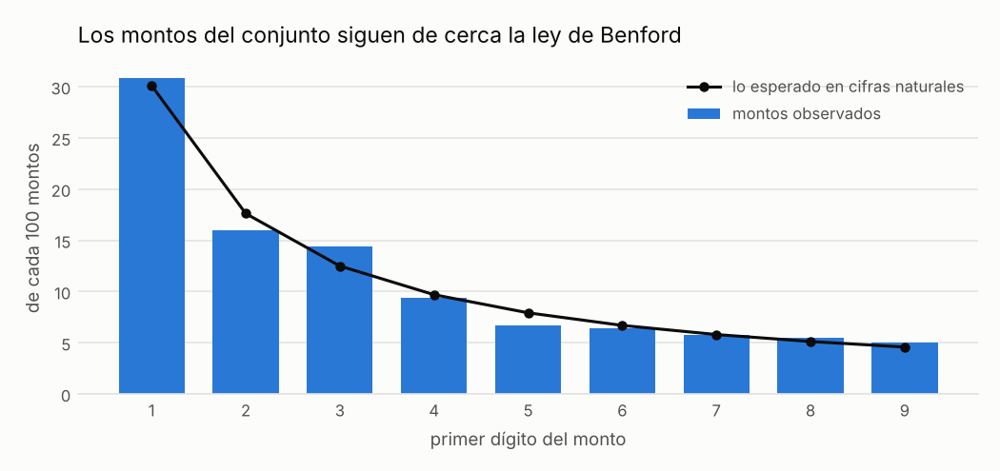
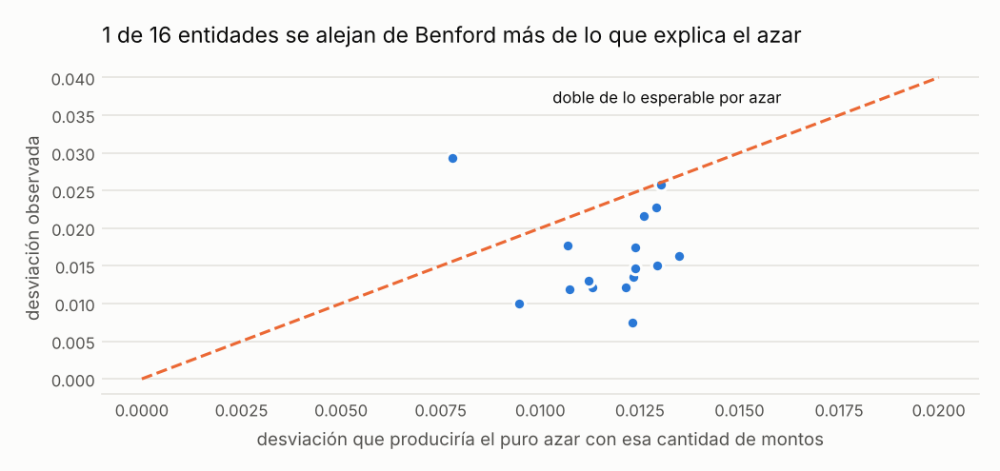

# Montos que no parecen naturales (ley de Benford)

<small>Señal C08 · responsable sugerido: Auditoría Interna (revisión analítica) · se revisa con frecuencia anual</small>

!!! warning "Señales, nunca acusaciones"
    Una alerta significa **«este caso merece revisión»**, no «hay una irregularidad». Este sitio
    no nombra ni ordena a ningún proveedor, funcionario o persona; las entidades públicas solo
    aparecen agrupadas.

!!! note "Datos simulados"
    Todas las cifras de este sitio vienen de **datos simulados**: un conjunto inventado con la
    misma estructura que las compras públicas reales, en el que se sembraron casos de riesgo a
    propósito para comprobar que las señales los encuentran. No describe a ninguna entidad real.
    Cuando corran los datos reales, este aviso cambiará solo.

## Qué busca

Revisa si, en el conjunto de montos de una entidad, los primeros dígitos aparecen con la frecuencia que se observa en cifras reales: muchos montos empiezan con 1, pocos con 9.

## Por qué importa

Cuando alguien inventa cifras, tiende a repartir los primeros dígitos de forma pareja. Es una prueba sobre el conjunto: nunca señala un contrato ni una persona.

## Un ejemplo concreto

!!! example "Caso inventado para explicar la señal"
    En una entidad inventada, solo 11 de cada 100 montos empezaban con 1, cuando en cifras naturales lo esperado es unos 30 de cada 100. Esa diferencia es demasiado grande para ser casualidad, dado el número de montos.

## Cuántas veces apareció

Se revisaron 16 entidades con suficientes montos <small>(datos simulados)</small>. Con la regla clásica, 8 parecerían alejarse de Benford; después de descontar lo que el puro azar produce con su cantidad de montos, quedan **1** <small>(datos simulados)</small>. Este control nunca marca un contrato: solo sirve para decidir dónde planificar una auditoría.



*Cómo leerlo:* las barras muestran, de cada 100 montos, cuántos empiezan con cada dígito; la línea negra es lo que se ve en cifras naturales (unos 30 de cada 100 empiezan con 1 y menos de 5 con 9).



*Cómo leerlo:* cada punto es una entidad, sin nombre. Más arriba significa que sus montos se alejan más de Benford. Los puntos sobre la línea naranja se alejan más del doble de lo que el puro azar produciría con su cantidad de montos; solo esos merecen atención.

## Qué revisar primero

1. ¿La entidad compra pocos tipos de artículos a precios fijos (eso también deforma la distribución)?
2. ¿Hay muchos montos justo debajo del límite de compra menor de 8 UIT (Unidad Impositiva Tributaria)?
3. Si la desviación persiste, pedir una muestra aleatoria de expedientes y compararlos con lo registrado.

## Cuándo es normal que salte

Estas situaciones disparan la señal sin que haya nada irregular. Antes de escalar una alerta,
descarte cada una:

- El límite de 8 UIT concentra montos que empiezan con 3 o 4
- Entidades que compran pocos tipos de artículos a precios fijos
- Conjuntos pequeños

??? info "Detalle técnico"

    **Regla exacta.** Para todas las adjudicaciones y para cada comprador con al menos min_n adjudicaciones ≥ min_amount, comparar la distribución del primer dígito con la ley de Benford usando la desviación absoluta media (MAD) y el estadístico chi-cuadrado. Se informa la clase de conformidad de Nigrini y se marca el conjunto solo si la MAD también supera excess_ratio veces la MAD esperada por puro azar para ese tamaño (los rangos fijos de Nigrini suponen muestras grandes; con 300 montos el azar solo ya da MAD ~ 0.014). Es una prueba sobre el conjunto: nunca marca un proceso individual y nunca entra al puntaje.

    **Umbral.** MAD mayor a 0.015 (no conformidad de Nigrini) y mayor al doble de la MAD por azar para ese tamaño

    **Objetivo de control.** Que el conjunto de montos adjudicados de una entidad se parezca a montos generados naturalmente.

    **Evidencia que genera.** Alcance, número de montos, frecuencias observadas y esperadas por dígito, MAD, chi-cuadrado, clase de conformidad

    **Falsas alarmas esperadas (antes de medir).** alta para entidades individuales (hay razones estructurales frecuentes)

    **Peso en el puntaje.** 0.0: Prueba agregada: excluida del puntaje por proceso por diseño.

    **Referencia metodológica.** Procedimiento analítico (Nigrini 2012); no es una bandera roja de OCP sobre procesos individuales

    **Parámetros**

    | parámetro | valor | unidad | origen |
    |---|---|---|---|
    | `min_n` | 300.0 | cantidad | valor del catálogo |
    | `min_amount` | 10.0 | soles | valor del catálogo |
    | `mad_close` | 0.006 |  | `thresholds.yaml: benford_mad_first_digit.close` |
    | `mad_acceptable` | 0.012 |  | `thresholds.yaml: benford_mad_first_digit.acceptable` |
    | `mad_marginal` | 0.015 |  | `thresholds.yaml: benford_mad_first_digit.marginal` |
    | `excess_ratio` | 2.0 | veces la MAD por azar | valor del catálogo (MAD mayor al doble de lo esperado por azar con el mismo tamaño (~percentil 99.9 por simulación)) |

    **Consulta SQL que ejecuta el motor** (`controls/sql/c08_benford.sql`)

    ```sql
    -- C08 Ley de Benford sobre los montos adjudicados: prueba agregada, nunca una alerta individual.
    -- Columnas de salida (controles agregados): scope_type, scope_id, n, mad, mad_null, chi2, conformity,
    --                                            flag, evidence
    -- mad_null = MAD esperada si los montos siguieran exactamente a Benford, para una muestra de tamaño n:
    --            (1/9) * sum_d sqrt(2 p_d (1 - p_d) / (pi n))
    -- flag     = MAD > excess_ratio * mad_null, es decir, más de lo que explica el azar del muestreo
    --            (excess_ratio 2.0 ~ percentil 99.9 bajo azar puro, por simulación; ver decisiones D20)
    WITH digits AS (
        SELECT buyer_id, CAST(left(CAST(CAST(floor(amount) AS BIGINT) AS VARCHAR), 1) AS INTEGER) AS d
        FROM f_award WHERE amount >= $min_amount
    ),
    scoped AS (
        SELECT 'all' AS scope_type, 'all' AS scope_id, d FROM digits
        UNION ALL
        SELECT 'buyer', buyer_id, d FROM digits
    ),
    sizes AS (SELECT scope_type, scope_id, count(*) AS n FROM scoped GROUP BY ALL),
    grid AS (
        SELECT s.scope_type, s.scope_id, s.n, g.d, log10(1 + 1.0 / g.d) AS expected
        FROM sizes s CROSS JOIN range(1, 10) g(d)
        WHERE s.n >= $min_n
    ),
    freq AS (
        SELECT g.*, coalesce(c.k, 0) AS observed_n, coalesce(c.k, 0) / g.n AS observed
        FROM grid g
        LEFT JOIN (SELECT scope_type, scope_id, d, count(*) AS k FROM scoped GROUP BY ALL) c
               USING (scope_type, scope_id, d)
    )
    SELECT scope_type, scope_id, any_value(n) AS n,
           avg(abs(observed - expected)) AS mad,
           avg(sqrt(2 * expected * (1 - expected) / (pi() * n))) AS mad_null,
           sum(power(observed_n - n * expected, 2) / (n * expected)) AS chi2,
           CASE WHEN avg(abs(observed - expected)) <= $mad_close THEN 'conformidad cercana'
                WHEN avg(abs(observed - expected)) <= $mad_acceptable THEN 'conformidad aceptable'
                WHEN avg(abs(observed - expected)) <= $mad_marginal THEN 'conformidad marginal'
                ELSE 'no conformidad' END AS conformity,
           avg(abs(observed - expected)) > $excess_ratio * avg(sqrt(2 * expected * (1 - expected) / (pi() * n)))
               AS flag,
           to_json(list(struct_pack(digit := d, observed := round(observed, 4),
                                    expected := round(expected, 4)) ORDER BY d))::VARCHAR AS evidence
    FROM freq
    GROUP BY scope_type, scope_id
    ```

