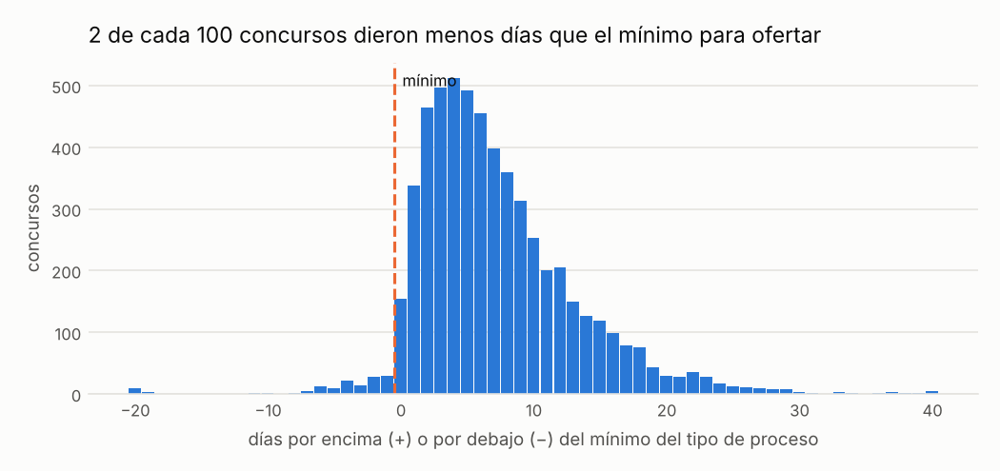

# Plazo demasiado corto para presentar ofertas

<small>Señal C03 · responsable sugerido: Responsable de Logística; secretaría del comité de selección · se revisa con frecuencia semanal (durante la convocatoria)</small>

!!! warning "Señales, nunca acusaciones"
    Una alerta significa **«este caso merece revisión»**, no «hay una irregularidad». Este sitio
    no nombra ni ordena a ningún proveedor, funcionario o persona; las entidades públicas solo
    aparecen agrupadas.

!!! note "Datos simulados"
    Todas las cifras de este sitio vienen de **datos simulados**: un conjunto inventado con la
    misma estructura que las compras públicas reales, en el que se sembraron casos de riesgo a
    propósito para comprobar que las señales los encuentran. No describe a ninguna entidad real.
    Cuando corran los datos reales, este aviso cambiará solo.

## Qué busca

Concursos en los que las empresas tuvieron menos días de los normales para preparar su oferta.

## Por qué importa

Un plazo muy corto deja fuera a quien no sabía del proceso con anticipación y favorece a quien ya estaba preparado.

## Un ejemplo concreto

!!! example "Caso inventado para explicar la señal"
    La Universidad Nacional de Ejemplo (entidad inventada) publicó una licitación para equipos de cómputo un viernes y cerró la recepción de ofertas el lunes: 3 días, cuando el mínimo para ese tipo de proceso es de 22. Ganó Sistemas Ficticios S.A. (proveedor inventado).

## Cuántas veces apareció

Marcó **134 procesos**, es decir 1 de cada 100 procesos revisados <small>(datos simulados)</small>. Por año: 2024: 72; 2025: 62.

En la prueba con casos sembrados, de cada 100 alertas de esta señal unas **52** cayeron en procesos que no tenían nada raro (ver [¿Funciona?](../funciona.md)).



*Cómo leerlo:* cada barra cuenta los concursos según cuántos días de margen dieron sobre el mínimo para su tipo de proceso. Las barras a la izquierda de la línea dieron menos días que el mínimo.

## Qué revisar primero

1. ¿Se usó un procedimiento de urgencia que permite plazos más cortos?
2. ¿Era una segunda convocatoria con plazos reducidos?
3. ¿Las fechas publicadas son correctas o hay un error de registro?

## Cuándo es normal que salte

Estas situaciones disparan la señal sin que haya nada irregular. Antes de escalar una alerta,
descarte cada una:

- Procedimientos de urgencia con plazos legalmente más cortos
- Segundas convocatorias publicadas con plazos reducidos
- Errores al registrar las fechas en la publicación

??? info "Detalle técnico"

    **Regla exacta.** Para procesos competitivos con un periodo de ofertas válido, marcar cuando los días enteros entre tenderPeriod.startDate y tenderPeriod.endDate son menos que el mínimo para el método (min_submission_days.by_method), o menos que el mínimo por defecto si el método no figura.

    **Umbral.** plazo menor al mínimo del método (días calendario; ver thresholds.yaml)

    **Objetivo de control.** Que los postores tengan tiempo suficiente para preparar sus ofertas.

    **Evidencia que genera.** Proceso, método, inicio, fin, días, mínimo aplicado

    **Falsas alarmas esperadas (antes de medir).** media (entre 20 y 40 de cada 100 alertas resultan normales)

    **Peso en el puntaje.** 0.5: Específica y accionable cuando el plazo se compara con el mínimo correcto.

    **Referencia metodológica.** OCP Cardinal R003 (Short submission period); OCP Red Flags for Integrity (2016)

    **Validación con datos simulados:** casos sembrados 50, encontrados 50; alertas 134, de las cuales 70 cayeron sobre procesos sin patrón sembrado.

    **Parámetros**

    | parámetro | valor | unidad | origen |
    |---|---|---|---|
    | `default_min_days` | 15 | días | `thresholds.yaml: min_submission_days.default.value` |
    | `by_method` | Licitación pública: 22; Concurso público: 22; Adjudicación simplificada: 8; Comparación de precios: 5; Subasta inversa electrónica: 5 |  | `thresholds.yaml: min_submission_days.by_method` |

    **Consulta SQL que ejecuta el motor** (`controls/sql/c03_short_submission_period.sql`)

    ```sql
    -- C03 Plazo de presentación de ofertas demasiado corto (Cardinal R003, mínimos por método).
    -- La unión por método ignora mayúsculas y tildes («Licitación Pública» = «Licitación pública»).
    WITH periods AS (
        SELECT p.ocid, p.buyer_id, p.year, p.method_details, p.tender_start, p.tender_end,
               date_diff('day', CAST(p.tender_start AS DATE), CAST(p.tender_end AS DATE)) AS days,
               coalesce(r.min_days, $default_min_days) AS min_days
        FROM f_process p
        LEFT JOIN ref_min_submission_days r
               ON lower(strip_accents(r.method_details)) = lower(strip_accents(p.method_details))
        WHERE p.is_competitive AND p.tender_start IS NOT NULL AND p.tender_end IS NOT NULL
    )
    SELECT s.ocid, s.buyer_id, a.supplier_id, s.year,
           greatest(0.1, 1.0 - s.days / s.min_days) AS severity,
           s.method_details AS scope_key,
           to_json(struct_pack(method := s.method_details, start := s.tender_start, "end" := s.tender_end,
                               days := s.days, min_days := s.min_days))::VARCHAR AS evidence
    FROM periods s
    LEFT JOIN (SELECT ocid, arg_min(supplier_id, award_id) AS supplier_id FROM f_award GROUP BY ocid) a
           USING (ocid)
    WHERE s.days < s.min_days
    ```

