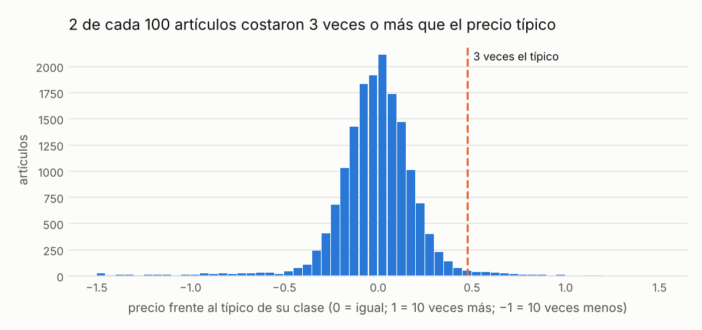

# Precios muy por encima de lo que pagan otros

<small>Señal C07 · responsable sugerido: Responsable de la categoría de compra; control de costos · se revisa con frecuencia mensual</small>

!!! warning "Señales, nunca acusaciones"
    Una alerta significa **«este caso merece revisión»**, no «hay una irregularidad». Este sitio
    no nombra ni ordena a ningún proveedor, funcionario o persona; las entidades públicas solo
    aparecen agrupadas.

!!! note "Datos simulados"
    Todas las cifras de este sitio vienen de **datos simulados**: un conjunto inventado con la
    misma estructura que las compras públicas reales, en el que se sembraron casos de riesgo a
    propósito para comprobar que las señales los encuentran. No describe a ninguna entidad real.
    Cuando corran los datos reales, este aviso cambiará solo.

## Qué busca

Artículos comprados a un precio unitario tres o más veces mayor que el precio típico que pagan las demás entidades por artículos de la misma clase.

## Por qué importa

El precio es donde está el dinero. Un sobreprecio grande puede ser sobrecosto, una especificación inflada o un error de unidades que esconde uno de los dos.

## Un ejemplo concreto

!!! example "Caso inventado para explicar la señal"
    El Hospital Regional de Ejemplo (entidad inventada) compró alimentos a Distribuidora Ficticia S.A.C. (proveedor inventado) a S/ 102.60 el kilo, cuando el precio típico de esa clase de alimentos en el país es S/ 16.80: seis veces más.

## Cuántas veces apareció

Marcó **218 procesos**, es decir 2 de cada 100 procesos revisados <small>(datos simulados)</small>. Por año: 2024: 115; 2025: 103.

En la prueba con casos sembrados, de cada 100 alertas de esta señal unas **5** cayeron en procesos que no tenían nada raro (ver [¿Funciona?](../funciona.md)).



*Cómo leerlo:* cada barra cuenta artículos según cuánto se alejó su precio del típico para su clase. La escala está comprimida para que «tres veces más caro» y «tres veces más barato» queden a la misma distancia del centro. A la derecha de la línea están los que costaron tres veces o más.

## Qué revisar primero

1. ¿La unidad de medida es la misma (caja contra unidad, kilo contra tonelada)?
2. ¿Es un artículo de mayor calidad dentro de una clase que mezcla productos distintos?
3. ¿El costo de llevarlo a una zona alejada explica la diferencia?

## Cuándo es normal que salte

Estas situaciones disparan la señal sin que haya nada irregular. Antes de escalar una alerta,
descarte cada una:

- Clases que mezclan artículos básicos y de alta gama
- Diferencias en la unidad de medida (caja contra unidad)
- Entregas pequeñas o en zonas alejadas con mayor costo logístico

??? info "Detalle técnico"

    **Regla exacta.** Para cada clase UNSPSC con al menos min_group artículos con precio, calcular la mediana del precio unitario adjudicado. Marcar los artículos cuyo precio unitario es al menos ratio veces esa mediana.

    **Umbral.** precio unitario 3 o más veces la mediana de su clase (clases con 20 o más artículos)

    **Objetivo de control.** Que los precios pagados estén en línea con lo que pagan otras entidades por la misma clase de artículo.

    **Evidencia que genera.** Proceso, clase del artículo, precio unitario, mediana de la clase, cuántas veces la supera, tamaño del grupo

    **Falsas alarmas esperadas (antes de medir).** media-alta (entre 30 y 60 de cada 100 alertas resultan normales)

    **Peso en el puntaje.** 0.5: El precio es donde está el dinero; la mezcla dentro de las clases limita la especificidad.

    **Referencia metodológica.** OCP Red Flags for Integrity (2016), etapa de adjudicación: precios lejos del mercado o inflados

    **Validación con datos simulados:** casos sembrados 40, encontrados 38; alertas 218, de las cuales 10 cayeron sobre procesos sin patrón sembrado.

    **Parámetros**

    | parámetro | valor | unidad | origen |
    |---|---|---|---|
    | `ratio` | 3.0 | veces la mediana | valor del catálogo |
    | `min_group` | 20.0 | cantidad | valor del catálogo |

    **Consulta SQL que ejecuta el motor** (`controls/sql/c07_price_outlier.sql`)

    ```sql
    -- C07 Precio unitario atípico frente a la mediana de su clase UNSPSC.
    WITH stats AS (
        SELECT classification_id, median(unit_amount) AS med, count(*) AS n
        FROM f_item GROUP BY 1
    ),
    hits AS (
        SELECT i.ocid, i.buyer_id, i.year, i.item_id, i.classification_id, i.unit_amount, s.med, s.n,
               i.unit_amount / s.med AS ratio
        FROM f_item i JOIN stats s USING (classification_id)
        WHERE s.n >= $min_group AND s.med > 0 AND i.unit_amount >= $ratio * s.med
    )
    SELECT h.ocid, h.buyer_id, a.supplier_id, h.year,
           least(1.0, ln(max(h.ratio)) / ln(10.0)) AS severity,
           arg_max(h.classification_id, h.ratio) AS scope_key,
           to_json(arg_max(struct_pack(item_id := h.item_id, class := h.classification_id,
                                       unit_price := h.unit_amount, class_median := round(h.med, 2),
                                       ratio := round(h.ratio, 2), class_n := h.n), h.ratio))::VARCHAR AS evidence
    FROM hits h
    LEFT JOIN (SELECT ocid, arg_min(supplier_id, award_id) AS supplier_id FROM f_award GROUP BY ocid) a
           USING (ocid)
    GROUP BY h.ocid, h.buyer_id, a.supplier_id, h.year
    ```

