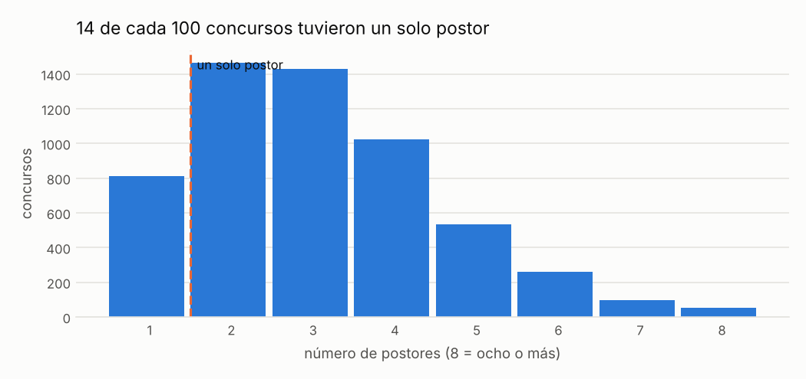

# Un solo postor en un concurso abierto

<small>Señal C02 · responsable sugerido: Responsable de Logística/Abastecimiento · se revisa con frecuencia mensual</small>

!!! warning "Señales, nunca acusaciones"
    Una alerta significa **«este caso merece revisión»**, no «hay una irregularidad». Este sitio
    no nombra ni ordena a ningún proveedor, funcionario o persona; las entidades públicas solo
    aparecen agrupadas.

!!! note "Datos simulados"
    Todas las cifras de este sitio vienen de **datos simulados**: un conjunto inventado con la
    misma estructura que las compras públicas reales, en el que se sembraron casos de riesgo a
    propósito para comprobar que las señales los encuentran. No describe a ninguna entidad real.
    Cuando corran los datos reales, este aviso cambiará solo.

## Qué busca

Procesos abiertos a la competencia en los que se presentó una sola empresa.

## Por qué importa

Sin competidores no hay presión sobre el precio. A veces es porque el mercado es pequeño; otras, porque las bases se escribieron a la medida de alguien o el aviso no se difundió.

## Un ejemplo concreto

!!! example "Caso inventado para explicar la señal"
    El Hospital Regional de Ejemplo (entidad inventada) convocó una adjudicación simplificada para comprar papel. Solo se presentó Papelera Ficticia E.I.R.L. (proveedor inventado), pese a que el papel lo venden decenas de empresas. Además, en esa entidad 30 de cada 100 procesos de ese tipo tuvieron un solo postor, frente a 19 de cada 100 en el resto del país.

## Cuántas veces apareció

Marcó **810 procesos**, es decir 6 de cada 100 procesos revisados <small>(datos simulados)</small>. Por año: 2024: 403; 2025: 407.

En la prueba con casos sembrados, de cada 100 alertas de esta señal unas **82** cayeron en procesos que no tenían nada raro (ver [¿Funciona?](../funciona.md)).



*Cómo leerlo:* cada barra cuenta los concursos según cuántas empresas se presentaron. La barra de la izquierda de la línea son los concursos con una sola oferta.

## Qué revisar primero

1. ¿Es un bien o servicio con pocos vendedores (equipos especializados, zonas alejadas)?
2. ¿Las bases pedían requisitos que solo cumple una empresa?
3. ¿En esta entidad pasa más seguido que en el resto del país?

## Cuándo es normal que salte

Estas situaciones disparan la señal sin que haya nada irregular. Antes de escalar una alerta,
descarte cada una:

- Mercados pequeños (equipos especializados, regiones alejadas)
- Procesos convocados de nuevo después de quedar desiertos
- Datos de ofertas incompletos en la publicación (solo se cuentan los postores publicados)

??? info "Detalle técnico"

    **Regla exacta.** Marcar cada proceso cuyo procurementMethod está en competitive_methods y cuyo número de postores distintos (según las ofertas, o numberOfTenderers si no hay ofertas) es 1.

    **Umbral.** postores = 1

    **Objetivo de control.** Que los procedimientos competitivos atraigan competencia real.

    **Evidencia que genera.** Proceso, método, número de postores, monto adjudicado

    **Falsas alarmas esperadas (antes de medir).** alta (entre 50 y 80 de cada 100 alertas resultan normales)

    **Peso en el puntaje.** 0.35: Muy frecuente y muchas veces estructural; evidencia débil sola, valiosa combinada.

    **Referencia metodológica.** OCP Cardinal R018 (Single bid received); OCP Red Flags for Integrity (2016)

    **Validación con datos simulados:** casos sembrados 60, encontrados 60; alertas 810, de las cuales 661 cayeron sobre procesos sin patrón sembrado.

    **Parámetros**

    | parámetro | valor | unidad | origen |
    |---|---|---|---|
    | `competitive_methods` | open, selective |  | valor del catálogo (valor por defecto de Cardinal) |

    **Consulta SQL que ejecuta el motor** (`controls/sql/c02_single_bid.sql`)

    ```sql
    -- C02 Un solo postor en un procedimiento competitivo (Cardinal R018).
    SELECT p.ocid, p.buyer_id, a.supplier_id, p.year,
           1.0 AS severity,
           p.method_details AS scope_key,
           to_json(struct_pack(method := p.method_details, procurement_method := p.procurement_method,
                               n_bidders := p.n_tenderers, award_amount := a.amount))::VARCHAR AS evidence
    FROM f_process p
    LEFT JOIN (SELECT ocid, arg_min(supplier_id, award_id) AS supplier_id, sum(amount) AS amount
               FROM f_award GROUP BY ocid) a USING (ocid)
    WHERE list_contains($competitive_methods, p.procurement_method)
      AND p.n_tenderers = 1
    ```

