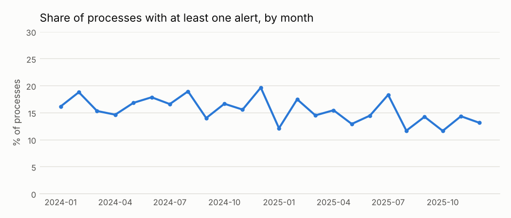
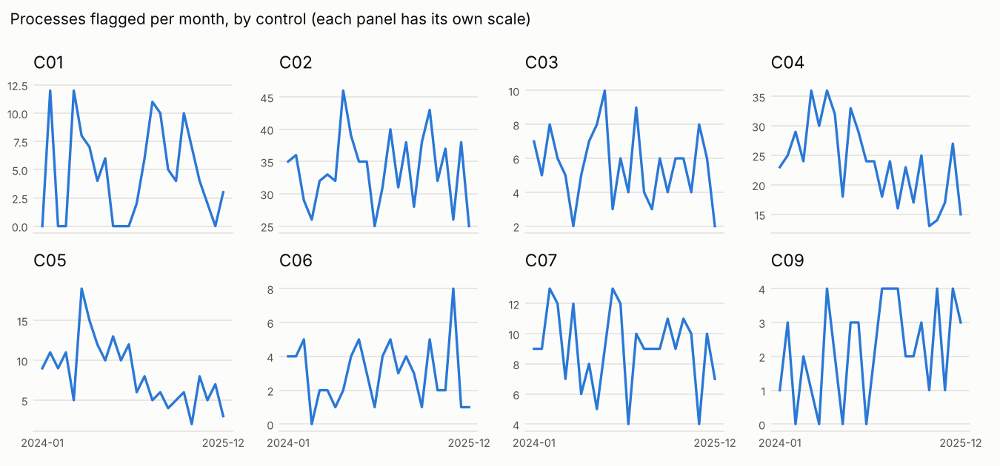

# Trends and aggregated views

!!! warning "Signals, never accusations"
    An alert means *"this deserves a review"*, not *"there is an irregularity"*. No supplier,
    official or person is ranked or named; public entities appear only in aggregated views.

Data: `outputs/distributions/trend_monthly.csv` and `trend_by_control.csv`.

## By procurement method

| method | processes | flagged | flagged_pct | p1 |
|---|---|---|---|---|
| Contratación menor | 6263 | 419 | 6.7 | 56 |
| Adjudicación simplificada | 2179 | 629 | 28.9 | 58 |
| Subasta inversa electrónica | 1482 | 332 | 22.4 | 30 |
| Comparación de precios | 1000 | 253 | 25.3 | 19 |
| Concurso público | 643 | 146 | 22.7 | 12 |
| Contratación directa | 614 | 47 | 7.7 | 0 |
| Licitación pública | 373 | 111 | 29.8 | 3 |

## By category (UNSPSC segment)

| segment | category | processes | flagged | flagged_pct |
|---|---|---|---|---|
| 72 | Construction works | 826 | 194 | 23.5 |
| 15 | Fuels | 678 | 142 | 20.9 |
| 81 | Engineering | 954 | 194 | 20.3 |
| 76 | Cleaning | 573 | 90 | 15.7 |
| 78 | Transport | 905 | 139 | 15.4 |
| 51 | Drugs | 1010 | 154 | 15.2 |
| 50 | Food | 1598 | 242 | 15.1 |
| 44 | Office supplies | 808 | 121 | 15.0 |
| 43 | IT equipment | 1115 | 164 | 14.7 |
| 14 | Paper | 1011 | 142 | 14.0 |
| 92 | Security | 1039 | 145 | 14.0 |
| 42 | Medical equipment | 1106 | 116 | 10.5 |
| 80 | Consulting | 931 | 94 | 10.1 |

## By type of entity

Entities are grouped by type; no individual entity is shown.

| entity_type | entities | processes | flagged | flagged_pct |
|---|---|---|---|---|
| District Municipality | 5 | 1253 | 147 | 11.7 |
| Executing Unit | 5 | 1603 | 260 | 16.2 |
| Ministry | 5 | 1467 | 255 | 17.4 |
| Provincial Municipality | 5 | 1911 | 246 | 12.9 |
| Public Hospital | 5 | 1462 | 202 | 13.8 |
| Public University | 5 | 2034 | 421 | 20.7 |
| Regional Government | 5 | 1330 | 215 | 16.2 |
| Regulatory Agency | 5 | 1494 | 191 | 12.8 |

## How alerts spread across entities

Number of entities by the share of their processes that carry at least one alert. The groups
are not ranked and no entity is named.

| share_of_processes_flagged | entities |
|---|---|
| b) 5-10% | 7 |
| c) 10-20% | 26 |
| d) >=20% | 7 |
